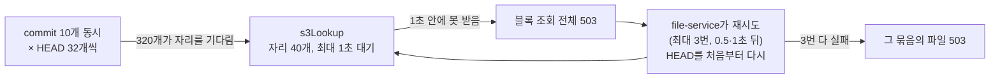

# 파일 업로드 성능 테스트

WEB과 같은 순서로 파일을 올리면서([001 2](../spec/001-file-upload-spec.md#2-파일-업로드)) 단계마다 걸린 시간과 DB·Redis 호출 수를 잰 테스트다. 큰 파일, 작은 파일 여러 개, 같은 파일 다시 올리기, 여러 사용자 동시 업로드, 크기가 섞인 폴더의 다섯 경우로, 블록 수·파일 수에 비례해 늘던 호출을 줄인 전후(#681)를 비교했다.

## 1. 테스트 시나리오

| 시나리오 | 하는 일 | 보는 것 |
|---|---|---|
| 1. 큰 파일 | 5GiB 파일 1개(4MiB 블록 1,280개 — 한 파일의 최대) | 블록 수에 비례하는 URL 발급·HEAD |
| 2. 작은 파일 | 10KiB 파일 1,000개(파일마다 블록 1개), commit은 100개씩 10번 | 파일 수에 비례하는 commit 비용 |
| 3. 다시 올리기 | 2의 1,000개를 올린 뒤, 같은 파일을 다른 폴더에 다시 올림 — 두 번째만 잰다 | 중복 제거: 블록이 이미 있어 URL 발급·PUT 없이 commit만 |
| 4. 동시 업로드 | 사용자 10명이 동시에 각자 10KiB 파일 100개 | 동시 부하에서 지연과 서로의 간섭 |
| 5. 혼합 폴더 | 업무 폴더 하나(파일 532개, 약 1GiB) — 아래 표 | 크기가 섞인 보통의 폴더 업로드 |

혼합 폴더는 하위 폴더 넷에 크기가 다른 파일을 넣는다. 크기는 범위 안에서 고르게 뽑되 매 라운드 같은 값이다(내용만 바뀐다). WEB처럼 묶음 하나에 파일 100개·블록 1,280개까지, 블록 64개(256MiB)를 넘는 파일은 혼자 한 묶음으로 나눠, 묶음 7개·블록 701개가 된다.

| 하위 폴더 | 파일 수 | 크기 |
|---|---|---|
| `코드` | 300 | 1~20KiB |
| `문서` | 150 | 50KiB~2MiB |
| `사진` | 80 | 2~6MiB |
| `영상` | 2 | 120MiB, 400MiB |

한 번 올릴 때 WEB처럼 네 단계를 차례로 밟고, 단계마다 시간·DB 쿼리 수(pg_stat_statements)·Redis 왕복 수(`INFO commandstats`)를 잰다.

| 단계 | 하는 일 |
|---|---|
| commit1 | 처음 commit — 없는 블록이 `needBlocks`로 돌아온다(다시 올리기는 여기서 끝난다) |
| presign | 업로드 URL 요청 (64개씩) |
| put | S3(LocalStack)에 블록 PUT (동시 6개) |
| commit2 | 2차 commit — S3에서 블록을 확인하고 버전을 만든다 |

- 라운드마다 새 드라이브에 올리고, 끝나면 그 드라이브의 S3 블록을 지운다. 서비스를 띄운 뒤 워밍업 1번, 시나리오마다 5라운드, 표는 중앙값이다.
- 동시 업로드는 10명이 barrier로 같이 시작한다. DB·Redis 수는 10명 합계이고, 단계 시간은 사람마다 잰 값의 중앙값과 가장 늦은 사람(max)이다. 전체 시간은 마지막 사람이 끝날 때까지다.
- 블록 내용은 시드로 그때그때 다시 만든다(5GiB를 메모리에 들고 있지 않는다).
- 서비스는 compose 네트워크 안에서 `X_USER_ID` 헤더로 file-service(10012)와 storage-service(10013)를 직접 호출한다.
- Redis 왕복은 `EVALSHA`·`ZADD`·`ZMSCORE` 같은 명령 수다. `upload-count.lua`가 안에서 실행하는 `INCR`·`PEXPIRE`는 왕복이 아니라 빼고 센다.

레포 루트에서, 인프라와 서비스가 떠 있는 상태로 실행한다.

```bash
.scripts/perf-test/scenario.sh up                        # pg_stat_statements + bench 컨테이너
.scripts/perf-test/004-upload/run.sh image tobe          # 작업 트리로 file·storage-service 이미지를 만들어 tobe로 태그
.scripts/perf-test/004-upload/run.sh deploy tobe         # 그 이미지로 두 서비스를 다시 띄움
.scripts/perf-test/004-upload/run.sh tobe-big5g 5 big 1280
.scripts/perf-test/004-upload/run.sh tobe-small 5 small 1000 10240
.scripts/perf-test/004-upload/run.sh tobe-dedup 5 dedup 1000 10240
.scripts/perf-test/004-upload/run.sh tobe-concurrent 5 concurrent 10 100 10240
.scripts/perf-test/004-upload/run.sh tobe-mixed 5 mixed
python3 summary.py tobe-big5g tobe-small tobe-dedup tobe-concurrent tobe-mixed   # 004-upload/에서
.scripts/perf-test/scenario.sh cleanup                   # 측정용 드라이브 삭제
```

스크립트는 `.scripts/perf-test/004-upload/`, 결과 원본(라운드마다 JSON 한 줄)은 그 아래 `results/`에 있다.

## 2. 테스트 결과

2026-10-17~18, 로컬(WSL2, LocalStack). 개선 전은 `dev`(35ebbd69), 개선 후는 아래 네 가지를 바꾼 `dev`(ac5490e2, #681)다.

| 바꾼 것 | 개선 전 | 개선 후 |
|---|---|---|
| URL 발급의 Redis 호출 | 블록마다 한도 세기 + 발급 시각 기록 (64개 요청에 128번) | 요청마다 한도 세기 1번 + 인덱스 키마다 `ZADD` 1번 (최대 17번) |
| URL 발급의 하루 한도 | 블록마다 세다가 넘으면 실패 — 앞 블록들은 URL 없이 한도만 깎임 | 요청 전체를 한 번에 세고, 안 들어가면 하나도 안 셈 |
| commit 사전 검사 | 파일마다 `uploadId` 조회 + 자리 조회 (100개에 200번) | 묶음마다 `uploadId` 1번 + 올라갈 폴더마다 1번 |
| commit의 S3 HEAD | 동시 8개 | 동시 32개, S3 커넥션 풀 50 → 85(벌크헤드 자리 합) |

**1. 큰 파일 (5GiB, 블록 1,280개)**

| 단계 | 개선 전 | 개선 후 |
|---|---|---|
| presign (요청 20번) | 3,198ms, Redis 2,562번 | **714ms (-78%)**, Redis 55번 |
| commit2 | 6,338ms, DB 1,295번 | 6,278ms (-1%), DB 1,295번 |
| commit1 | 122ms, DB 4번 | 171ms, DB 4번 |
| put | 83.7초 | 83.7초 |

**2. 작은 파일 (10KiB × 1,000개)**

| 단계 | 개선 전 | 개선 후 |
|---|---|---|
| commit1 | 3,232ms, DB 2,020번 | **485ms (-85%), DB 40번** |
| presign | 1,688ms, Redis 2,000번 | **377ms (-78%)**, Redis 47번 |
| commit2 | 26.8초, DB 13,021번 | 23.3초 (-13%), DB 11,041번 |
| put | 5.6초 | 5.6초 |

**3. 다시 올리기 (10KiB × 1,000개를 다른 폴더에)**

| 단계 | 개선 전 | 개선 후 |
|---|---|---|
| commit1 (전부 여기서 끝남) | 24.9초, DB 13,021번 | 21.1초 (-15%), DB 11,041번 |

**4. 동시 업로드 (10명 × 10KiB 100개)**

| | 개선 전 | 개선 후 |
|---|---|---|
| 전체 (마지막 사람까지) | 16.8초 | **24.4초 (+45%)** |
| commit1 (중앙값 / 최대) | 1,126 / 1,199ms | 570 / 596ms |
| presign | 423 / 460ms | 120 / 143ms |
| put | 6.9 / 7.0초 | 6.6 / 6.7초 |
| commit2 | 8.3 / 8.4초 | **10.1 / 16.9초** |
| DB 쿼리 / Redis 왕복 (10명 합) | 15,050번 / 2,322번 | 11,090번 / 595번 |

**5. 혼합 폴더 (파일 532개, 블록 701개, 묶음 7개)**

| 단계 | 개선 전 | 개선 후 |
|---|---|---|
| commit1 | 2,037ms, DB 1,078번 | **504ms (-75%), DB 30번** |
| presign | 1,773ms, Redis 1,402번 | **440ms (-75%)**, Redis 37번 |
| put | 14.2초 | 13.8초 |
| commit2 | 16.6초, DB 7,635번 | 15.2초 (-9%), DB 6,587번 |
| 합계 | 34.6초 | 29.9초 (-14%) |

- **URL 발급과 1차 commit**은 다섯 경우 모두 호출 수가 줄어든 만큼 빨라졌다. 블록 수·파일 수에 비례하던 호출이 요청·묶음마다 몇 번으로 바뀌었다.
- **혼합 폴더**에서도 가장 긴 단계는 블록 전송(put)이 아니라 2차 commit이다. 파일 532개가 파일마다 트랜잭션을 하나씩 연다([3](#3-남은-병목-파일마다-트랜잭션)).
- **다시 올리기**는 블록이 모두 이미 있어 URL 발급·PUT·HEAD가 없고, 시간이 전부 파일마다의 버전 생성이다. 그래서 작은 파일의 2차 commit과 같은 비용이 그대로 보인다([3](#3-남은-병목-파일마다-트랜잭션)).
- **큰 파일의 2차 commit**은 그대로다. 시간 대부분이 블록 1,280개의 HEAD인데, 로컬 LocalStack은 동시 요청을 늘려도 HEAD가 빨라지지 않았다.
- **동시 업로드의 2차 commit은 오히려 느려졌다.** HEAD 동시 32개 때문이다([4](#4-head-동시-요청-32개의-역효과)).
- 큰 파일의 commit1(122ms → 171ms)은 코드 차이가 아니다. 블록 64개로 다시 재 보니 같은 개선 후 이미지가 띄워 둔 채로는 61~72ms, 다시 띄운 직후에는 105~152ms였다(개선 전은 다시 띄운 직후 105~132ms). 워밍업 1라운드로는 JVM이 덜 데워져 생기는 편차다.
- `reWriteBatchedInserts`(blocklist 배치를 여러 행 INSERT 하나로)도 1GiB 파일로 재 봤다. 2차 commit의 DB 쿼리 집계는 줄지만(271번 → 32번) 시간은 차이가 없어, #667의 측정(배치 50과 잡음 수준 차이)대로 켜지 않았다.

## 3. 남은 병목: 파일마다 트랜잭션

작은 파일의 2차 commit(1,000개 23초)과 다시 올리기(21초)가 업로드 전체에서 가장 길고, 혼합 폴더(15초)에서도 블록 전송보다 길다. 파일 100개짜리 commit 하나를 pg_stat_statements로 보면 DB 실행 시간은 합쳐서 약 130ms인데, 요청은 2.3초가 걸린다.

| 파일마다 (commit2) | 쿼리 |
|---|---|
| 폴더 행 잠금, 파일 행 잠금 | 2 |
| 블록 행 잠금, 블록 참조 upsert | 2 |
| 파일 insert(새 파일) 후 버전 연결 update | 2 |
| 버전 insert, blocklist insert | 2 |
| 최근 문서함(file_access) 조회 + insert | 2 |
| 사용량 확정(namespace update) | 1 |
| 트랜잭션 commit | 1 |

- 파일마다 **트랜잭션을 따로** 연다([001 2-3](../spec/001-file-upload-spec.md#2-3-commit) — 한 파일이 실패해도 나머지는 저장되게). 그래서 쿼리 11번과 commit이 파일 수만큼 그대로 반복되고, 시간은 쿼리 실행이 아니라 왕복과 트랜잭션 commit에서 나간다.
- 같은 폴더에 올리는 파일 100개가 상위 폴더 행을 각자 다시 잠그고, 사용량 행(namespace)도 파일마다 갱신한다.
- 줄이려면 묶음 하나를 트랜잭션 하나로 묶고 파일마다 savepoint를 두는 식으로 바꿔야 한다. 실패 범위·잠금 순서([001 4](../spec/001-file-upload-spec.md#4-동시-요청과-잠금))가 바뀌는 설계 변경이라 #681에서는 하지 않았다.

## 4. HEAD 동시 요청 32개의 역효과

동시 업로드에서 개선 후가 느려진 원인을 가리려고, storage-service의 두 변경을 하나씩 되돌려 다시 쟀다.

| storage-service | HEAD 동시 | S3 커넥션 풀 | 전체 (마지막 사람까지) | commit2 (중앙값 / 최대) |
|---|---|---|---|---|
| 개선 전 | 8 | 50 | 16.8초 | 8.3 / 8.4초 |
| 개선 후 | 32 | 85 | 24.4초 (다시 재서 25.0초) | 10.1 / 16.9초 |
| A: HEAD만 되돌림 | 8 | 85 | 16.2초 | 8.5 / 8.7초 |
| B: 풀만 되돌림 | 32 | 50 | 25.7초, 다음 라운드는 2차 commit 100개 전부 503으로 실패 | 11.6 / 17.2초 |

HEAD 동시 요청 수가 원인이다. 측정 동안 storage-service 로그에 `Bulkhead 's3Lookup' is full`(자리를 못 받아 거절)이 245번 남았다.



- 자리 40개를 놓고 기다리는 HEAD가 개선 전에는 80개(8 × 10), 개선 후에는 320개(32 × 10)다. 기다리는 줄이 4배라, HEAD가 느려지면 1초 안에 자리를 못 받는 HEAD가 생긴다. 하나라도 못 받으면 그 commit의 블록 조회 전체가 503이고, file-service는 재시도하며 HEAD를 처음부터 다시 보낸다. 일이 늘어 더 느려지고, 재시도가 다 실패하면 파일이 실패한다(B).
- 기다리는 시간은 대략 `줄 길이 ÷ 자리 수 × HEAD 하나의 시간`이다. 1초를 넘는 건 HEAD 하나가 개선 후는 125ms, 개선 전은 500ms를 넘을 때다. LocalStack은 동시 부하에서 HEAD가 이만큼 느려진다. AWS S3(HEAD 수십 ms)에서는 같은 10명으로는 넘지 않겠지만, 동시 commit이 늘거나 S3가 느려지면 32개 쪽이 먼저 거절되기 시작한다.
- 32개로 늘린 이득(큰 파일 2차 commit이 빨라짐)은 로컬에서 보이지 않았다. AWS에서 잰 결과는 [5](#5-aws-s3에서-head-측정).

## 5. AWS S3에서 HEAD 측정

LocalStack은 HEAD 시간이 실제 S3와 달라서, demo 환경에서 실제 S3로 다시 쟀다.

- demo ECS 클러스터에 일회성 Fargate 작업(2 vCPU, 4GB)을 띄웠다. storage-service와 같은 서브넷·보안 그룹·작업 역할을 써서, S3 게이트웨이 엔드포인트로 같은 버킷에 HEAD를 보낸다.
- 버킷의 `blocks/bench-…/`에 1KiB 객체 1,280개를 올려 HEAD(`ChecksumMode=ENABLED`)하고, 끝나면 지웠다.
- commit의 블록 조회는 앱과 같은 규칙으로 흉내 냈다. commit마다 HEAD를 N개씩 보내고, 모든 commit이 자리 40개(최대 1초 대기)를 나눠 쓴다. 하나라도 자리를 못 받으면 조회 전체가 실패하고, file-service처럼 0.5초·1초 뒤 처음부터 다시(최대 3번) 한다. 각 3번 재서 중간값이다.
- 스크립트는 `.scripts/perf-test/004-upload/s3-head.py`, 결과 원본은 `results/aws-s3-head.json`(2026-10-18).

**HEAD 하나**: p50 14ms, p90 17ms, p99 67ms.

**동시 요청 수에 따른 처리량 (HEAD 1,280개)**

| 동시 | 초당 HEAD | HEAD 하나 p50 / p99 |
|---|---|---|
| 1 | 68 | 14 / 52ms |
| 8 | 491 | 15 / 64ms |
| 16 | 750 | 19 / 102ms |
| 32 | 731 | 34 / 218ms |
| 40 | 743 | 40 / 209ms |
| 64 | 687 | 38 / 426ms |

**commit의 블록 조회 (자리 40개, 최대 1초 대기)**

| 상황 | commit당 8개 | commit당 32개 |
|---|---|---|
| 5GiB 파일 1개 (블록 1,280개) | 2.3초 | 1.8초 |
| commit 10개 동시 × 블록 100개 | 1.35초 | 1.38초 |
| commit 10개 동시 × 블록 1,280개 | 17.2초 | 17.0초 |
| commit 30개 동시 × 블록 100개 | 4.1초 | 4.1초 |

모든 경우에 자리 거절·재시도·실패는 0번이었다.

- **실제 S3에서는 로컬의 역효과가 나지 않았다.** HEAD가 14ms라 자리가 빨리 돌아서, commit 30개가 겹쳐도 1초 안에 자리를 받았다. 로컬은 부하가 걸리면 LocalStack의 HEAD가 크게 느려져서 그 경계를 넘었다.
- **처리량은 동시 16개 근처에서 멈춘다(초당 약 740개).** 그 위로는 HEAD 하나가 느려질 뿐 전체는 빨라지지 않는다. 같은 접두어의 S3 한도(초당 5,500건)보다 훨씬 낮아, 측정 쪽(Python, 2 vCPU)의 한계로 보인다. storage-service(Java, demo 0.5 vCPU)의 한계는 따로 재지 않았다.
- **commit이 겹치면 commit당 개수는 상관없다.** 인스턴스 전체 처리량을 나눠 쓰므로, 10개·30개가 겹칠 때 8개와 32개의 차이가 없다.
- **32개가 이득인 경우는 큰 파일 하나를 혼자 올릴 때뿐**이고, 5GiB 파일에서 0.5초다(2.3초 → 1.8초). 같은 파일의 블록 전송이 몇 분 걸리는 것에 비하면 체감되지 않는다.
- 그래서 8개로 둔다. 늘려서 얻는 것은 작고, S3가 느려지는 때(로컬이 보여 준 경우)에는 거절과 재시도가 먼저 생긴다.

**로컬 측정의 한계**

- 로컬 `dev` 프로필은 SQL을 전부 stdout에 찍는다(`show_sql`). 쿼리마다 드는 고정 비용이 운영보다 크게 잡힌다.
- LocalStack은 AWS S3와 지연 특성이 다르다. HEAD 관련 수치는 5의 AWS 측정을 기준으로 본다.
