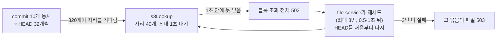

# 파일 업로드 성능 테스트

WEB과 같은 순서로 파일을 올리면서([001 2](../spec/001-file-upload-spec.md#2-파일-업로드)) 단계마다 걸린 시간과 DB·Redis 호출 수를 잰 테스트다. 큰 파일, 작은 파일 여러 개, 같은 파일 다시 올리기, 여러 사용자 동시 업로드의 네 경우로, 블록 수·파일 수에 비례해 늘던 호출을 줄인 전후(#681)를 비교했다.

## 1. 테스트 시나리오

| 시나리오 | 하는 일 | 보는 것 |
|---|---|---|
| 1. 큰 파일 | 5GiB 파일 1개(4MiB 블록 1,280개 — 한 파일의 최대) | 블록 수에 비례하는 URL 발급·HEAD |
| 2. 작은 파일 | 10KiB 파일 1,000개(파일마다 블록 1개), commit은 100개씩 10번 | 파일 수에 비례하는 commit 비용 |
| 3. 다시 올리기 | 2의 1,000개를 올린 뒤, 같은 파일을 다른 폴더에 다시 올림 — 두 번째만 잰다 | 중복 제거: 블록이 이미 있어 URL 발급·PUT 없이 commit만 |
| 4. 동시 업로드 | 사용자 10명이 동시에 각자 10KiB 파일 100개 | 동시 부하에서 지연과 서로의 간섭 |

한 번 올릴 때 WEB처럼 네 단계를 차례로 밟고, 단계마다 시간·DB 쿼리 수(pg_stat_statements)·Redis 왕복 수(`INFO commandstats`)를 잰다.

| 단계 | 하는 일 |
|---|---|
| commit1 | 처음 commit — 없는 블록이 `needBlocks`로 돌아온다(다시 올리기는 여기서 끝난다) |
| presign | 업로드 URL 요청 (64개씩) |
| put | S3(LocalStack)에 블록 PUT (동시 6개) |
| commit2 | 2차 commit — S3에서 블록을 확인하고 버전을 만든다 |

- 라운드마다 새 드라이브에 올리고, 끝나면 그 드라이브의 S3 블록을 지운다. 서비스를 띄운 뒤 워밍업 1번, 시나리오마다 5라운드, 표는 중앙값이다.
- 동시 업로드는 10명이 barrier로 같이 시작한다. DB·Redis 수는 10명 합계이고, 단계 시간은 사람마다 잰 값의 중앙값과 가장 늦은 사람(max)이다. 전체 시간은 마지막 사람이 끝날 때까지다.
- 블록 내용은 시드로 그때그때 다시 만든다(5GiB를 메모리에 들고 있지 않는다).
- 서비스는 compose 네트워크 안에서 `X_USER_ID` 헤더로 file-service(10012)와 storage-service(10013)를 직접 호출한다.
- Redis 왕복은 `EVALSHA`·`ZADD`·`ZMSCORE` 같은 명령 수다. `upload-count.lua`가 안에서 실행하는 `INCR`·`PEXPIRE`는 왕복이 아니라 빼고 센다.

레포 루트에서, 인프라와 서비스가 떠 있는 상태로 실행한다.

```bash
.scripts/perf-test/scenario.sh up                        # pg_stat_statements + bench 컨테이너
.scripts/perf-test/004-upload/run.sh image tobe          # 작업 트리로 file·storage-service 이미지를 만들어 tobe로 태그
.scripts/perf-test/004-upload/run.sh deploy tobe         # 그 이미지로 두 서비스를 다시 띄움
.scripts/perf-test/004-upload/run.sh tobe-big5g 5 big 1280
.scripts/perf-test/004-upload/run.sh tobe-small 5 small 1000 10240
.scripts/perf-test/004-upload/run.sh tobe-dedup 5 dedup 1000 10240
.scripts/perf-test/004-upload/run.sh tobe-concurrent 5 concurrent 10 100 10240
python3 summary.py tobe-big5g tobe-small tobe-dedup tobe-concurrent   # 004-upload/에서
.scripts/perf-test/scenario.sh cleanup                   # 측정용 드라이브 삭제
```

스크립트는 `.scripts/perf-test/004-upload/`, 결과 원본(라운드마다 JSON 한 줄)은 그 아래 `results/`에 있다.

## 2. 테스트 결과

2026-10-17~18, 로컬(WSL2, LocalStack). 개선 전은 `dev`(35ebbd69), 개선 후는 아래 네 가지를 바꾼 `dev`(ac5490e2, #681)다.

| 바꾼 것 | 개선 전 | 개선 후 |
|---|---|---|
| URL 발급의 Redis 호출 | 블록마다 한도 세기 + 발급 시각 기록 (64개 요청에 128번) | 요청마다 한도 세기 1번 + 인덱스 키마다 `ZADD` 1번 (최대 17번) |
| URL 발급의 하루 한도 | 블록마다 세다가 넘으면 실패 — 앞 블록들은 URL 없이 한도만 깎임 | 요청 전체를 한 번에 세고, 안 들어가면 하나도 안 셈 |
| commit 사전 검사 | 파일마다 `uploadId` 조회 + 자리 조회 (100개에 200번) | 묶음마다 `uploadId` 1번 + 올라갈 폴더마다 1번 |
| commit의 S3 HEAD | 동시 8개 | 동시 32개, S3 커넥션 풀 50 → 85(벌크헤드 자리 합) |

**1. 큰 파일 (5GiB, 블록 1,280개)**

| 단계 | 개선 전 | 개선 후 |
|---|---|---|
| presign (요청 20번) | 3,198ms, Redis 2,562번 | **714ms (-78%)**, Redis 55번 |
| commit2 | 6,338ms, DB 1,295번 | 6,278ms (-1%), DB 1,295번 |
| commit1 | 122ms, DB 4번 | 171ms, DB 4번 |
| put | 83.7초 | 83.7초 |

**2. 작은 파일 (10KiB × 1,000개)**

| 단계 | 개선 전 | 개선 후 |
|---|---|---|
| commit1 | 3,232ms, DB 2,020번 | **485ms (-85%), DB 40번** |
| presign | 1,688ms, Redis 2,000번 | **377ms (-78%)**, Redis 47번 |
| commit2 | 26.8초, DB 13,021번 | 23.3초 (-13%), DB 11,041번 |
| put | 5.6초 | 5.6초 |

**3. 다시 올리기 (10KiB × 1,000개를 다른 폴더에)**

| 단계 | 개선 전 | 개선 후 |
|---|---|---|
| commit1 (전부 여기서 끝남) | 24.9초, DB 13,021번 | 21.1초 (-15%), DB 11,041번 |

**4. 동시 업로드 (10명 × 10KiB 100개)**

| | 개선 전 | 개선 후 |
|---|---|---|
| 전체 (마지막 사람까지) | 16.8초 | **24.4초 (+45%)** |
| commit1 (중앙값 / 최대) | 1,126 / 1,199ms | 570 / 596ms |
| presign | 423 / 460ms | 120 / 143ms |
| put | 6.9 / 7.0초 | 6.6 / 6.7초 |
| commit2 | 8.3 / 8.4초 | **10.1 / 16.9초** |
| DB 쿼리 / Redis 왕복 (10명 합) | 15,050번 / 2,322번 | 11,090번 / 595번 |

- **URL 발급과 1차 commit**은 네 경우 모두 호출 수가 줄어든 만큼 빨라졌다. 블록 수·파일 수에 비례하던 호출이 요청·묶음마다 몇 번으로 바뀌었다.
- **다시 올리기**는 블록이 모두 이미 있어 URL 발급·PUT·HEAD가 없고, 시간이 전부 파일마다의 버전 생성이다. 그래서 작은 파일의 2차 commit과 같은 비용이 그대로 보인다([3](#3-남은-병목-파일마다-트랜잭션)).
- **큰 파일의 2차 commit**은 그대로다. 시간 대부분이 블록 1,280개의 HEAD인데, 로컬 LocalStack은 동시 요청을 늘려도 HEAD가 빨라지지 않았다.
- **동시 업로드의 2차 commit은 오히려 느려졌다.** HEAD 동시 32개 때문이다([4](#4-head-동시-요청-32개의-역효과)).
- 큰 파일의 commit1(122ms → 171ms)은 코드 차이가 아니다. 블록 64개로 다시 재 보니 같은 개선 후 이미지가 띄워 둔 채로는 61~72ms, 다시 띄운 직후에는 105~152ms였다(개선 전은 다시 띄운 직후 105~132ms). 워밍업 1라운드로는 JVM이 덜 데워져 생기는 편차다.
- `reWriteBatchedInserts`(blocklist 배치를 여러 행 INSERT 하나로)도 1GiB 파일로 재 봤다. 2차 commit의 DB 쿼리 집계는 줄지만(271번 → 32번) 시간은 차이가 없어, #667의 측정(배치 50과 잡음 수준 차이)대로 켜지 않았다.

## 3. 남은 병목: 파일마다 트랜잭션

작은 파일의 2차 commit(1,000개 23초)과 다시 올리기(21초)가 업로드 전체에서 가장 길다. 파일 100개짜리 commit 하나를 pg_stat_statements로 보면 DB 실행 시간은 합쳐서 약 130ms인데, 요청은 2.3초가 걸린다.

| 파일마다 (commit2) | 쿼리 |
|---|---|
| 폴더 행 잠금, 파일 행 잠금 | 2 |
| 블록 행 잠금, 블록 참조 upsert | 2 |
| 파일 insert(새 파일) 후 버전 연결 update | 2 |
| 버전 insert, blocklist insert | 2 |
| 최근 문서함(file_access) 조회 + insert | 2 |
| 사용량 확정(namespace update) | 1 |
| 트랜잭션 commit | 1 |

- 파일마다 **트랜잭션을 따로** 연다([001 2-3](../spec/001-file-upload-spec.md#2-3-commit) — 한 파일이 실패해도 나머지는 저장되게). 그래서 쿼리 11번과 commit이 파일 수만큼 그대로 반복되고, 시간은 쿼리 실행이 아니라 왕복과 트랜잭션 commit에서 나간다.
- 같은 폴더에 올리는 파일 100개가 상위 폴더 행을 각자 다시 잠그고, 사용량 행(namespace)도 파일마다 갱신한다.
- 줄이려면 묶음 하나를 트랜잭션 하나로 묶고 파일마다 savepoint를 두는 식으로 바꿔야 한다. 실패 범위·잠금 순서([001 4](../spec/001-file-upload-spec.md#4-동시-요청과-잠금))가 바뀌는 설계 변경이라 #681에서는 하지 않았다.

## 4. HEAD 동시 요청 32개의 역효과

동시 업로드에서 개선 후가 느려진 원인을 가리려고, storage-service의 두 변경을 하나씩 되돌려 다시 쟀다.

| storage-service | HEAD 동시 | S3 커넥션 풀 | 전체 (마지막 사람까지) | commit2 (중앙값 / 최대) |
|---|---|---|---|---|
| 개선 전 | 8 | 50 | 16.8초 | 8.3 / 8.4초 |
| 개선 후 | 32 | 85 | 24.4초 (다시 재서 25.0초) | 10.1 / 16.9초 |
| A: HEAD만 되돌림 | 8 | 85 | 16.2초 | 8.5 / 8.7초 |
| B: 풀만 되돌림 | 32 | 50 | 25.7초, 다음 라운드는 2차 commit 100개 전부 503으로 실패 | 11.6 / 17.2초 |

HEAD 동시 요청 수가 원인이다. 측정 동안 storage-service 로그에 `Bulkhead 's3Lookup' is full`(자리를 못 받아 거절)이 245번 남았다.



- 자리 40개를 놓고 기다리는 HEAD가 개선 전에는 80개(8 × 10), 개선 후에는 320개(32 × 10)다. 기다리는 줄이 4배라, HEAD가 느려지면 1초 안에 자리를 못 받는 HEAD가 생긴다. 하나라도 못 받으면 그 commit의 블록 조회 전체가 503이고, file-service는 재시도하며 HEAD를 처음부터 다시 보낸다. 일이 늘어 더 느려지고, 재시도가 다 실패하면 파일이 실패한다(B).
- 기다리는 시간은 대략 `줄 길이 ÷ 자리 수 × HEAD 하나의 시간`이다. 1초를 넘는 건 HEAD 하나가 개선 후는 125ms, 개선 전은 500ms를 넘을 때다. LocalStack은 동시 부하에서 HEAD가 이만큼 느려진다. AWS S3(HEAD 수십 ms)에서는 같은 10명으로는 넘지 않겠지만, 동시 commit이 늘거나 S3가 느려지면 32개 쪽이 먼저 거절되기 시작한다.
- 32개로 늘린 이득(큰 파일 2차 commit이 빨라짐)은 로컬에서 보이지 않았다. AWS에서 재기 전까지는 근거가 없는 변경이다.
- 그래서 **8개로 되돌리고 커넥션 풀 85는 남겼다**(#683). 이 조합이 A다. 풀은 벌크헤드가 허락하는 S3 호출 수(40 + 40 + 5)와 실제 연결 수를 맞추는 설정이라, HEAD 개수와 상관없이 둔다. B에서 풀 50일 때 과부하가 실패까지 간 것도 자리를 받은 호출이 연결을 또 기다렸기 때문으로 본다(1라운드 결과).

**로컬 측정의 한계**

- 로컬 `dev` 프로필은 SQL을 전부 stdout에 찍는다(`show_sql`). 쿼리마다 드는 고정 비용이 운영보다 크게 잡힌다.
- LocalStack은 AWS S3와 지연 특성이 다르다. HEAD 동시 요청 수의 이득과 역효과의 경계는 AWS에서 다시 재야 한다.
