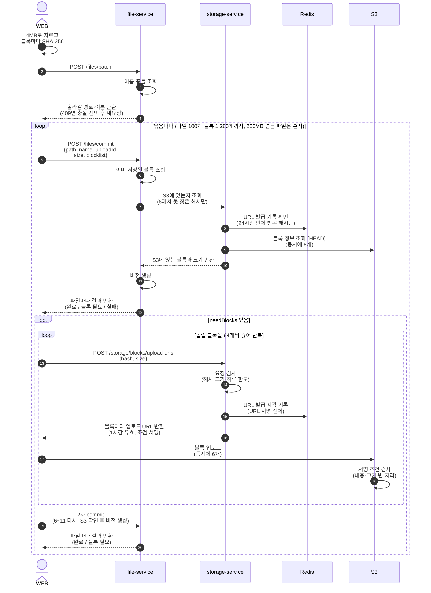
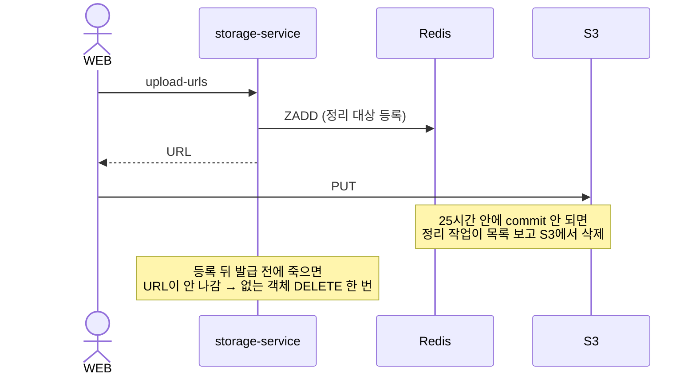
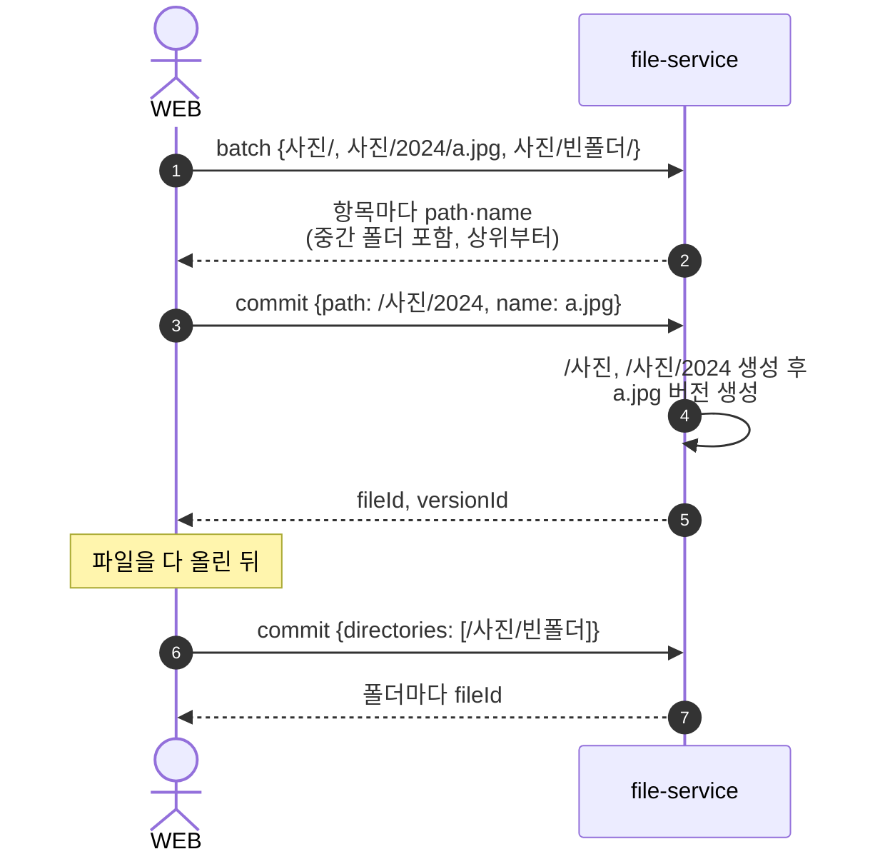
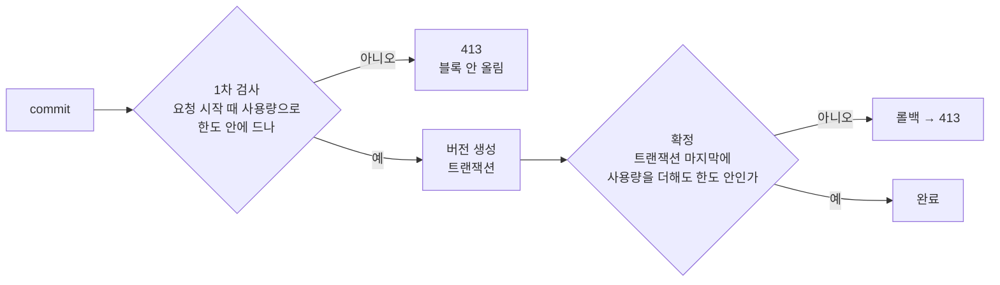
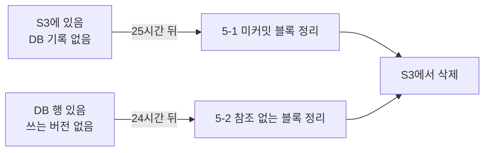

# 파일 업로드 스펙

이 문서는 파일·폴더 업로드가 어떻게 동작하는지 정의합니다.

⚠️ 이 문서가 기준입니다. 코드가 이 문서와 다르면 코드를 고치고, 동작을 바꾸려면 이 문서를 먼저 고칩니다.

---

## 목차

- [1. 구성 요소](#1-구성-요소)
- [2. 파일 업로드](#2-파일-업로드)
  - [2-1. 충돌 조회 (batch)](#2-1-충돌-조회-batch)
  - [2-2. 해시 계산과 묶기 (WEB)](#2-2-해시-계산과-묶기-web)
  - [2-3. commit](#2-3-commit)
  - [2-4. 블록 전송](#2-4-블록-전송)
  - [2-5. 2차 commit](#2-5-2차-commit)
  - [2-6. 폴더 업로드](#2-6-폴더-업로드)
- [3. 드라이브 용량 한도](#3-드라이브-용량-한도)
- [4. 동시 요청과 잠금](#4-동시-요청과-잠금)
- [5. 블록 정리](#5-블록-정리)
  - [5-1. 미커밋 블록 정리](#5-1-미커밋-블록-정리)
  - [5-2. 참조 없는 블록 정리](#5-2-참조-없는-블록-정리)
  - [5-3. 과거 버전 정리](#5-3-과거-버전-정리)
- [6. 제한값](#6-제한값)

---

## 1. 구성 요소

| 구성 요소 | 역할 |
|---|---|
| **WEB** | 파일을 블록으로 나눠 해시를 계산하고, 서버에 없는 블록만 S3에 직접 올린다 |
| **gateway-service** | 세션을 확인하고 `X_USER_ID`를 붙여 요청을 넘긴다 |
| **file-service** | 이름 충돌 조회, commit(버전 생성), 드라이브 용량 한도, 버전·참조 없는 블록 정리 |
| **storage-service** | 블록 업로드 URL 발급(Presigned), commit 전 올라온 블록 확인(S3 HEAD), commit되지 않은 블록 정리 |
| **S3** | 블록 저장 (받은 바이트 그대로, SHA-256 체크섬 검증·보관, 버킷 기본 암호화) |
| **Redis** | commit되지 않은 블록의 정리 대상 목록, 사용자별 URL 발급 횟수 (storage 전용 Redis, [006 2-4-6](006-resilience-spec.md#2-4-6-redis-분리)) |
| **file_db** | 파일·버전·블록(`block`)·드라이브 용량(`namespace`) |

---

## 2. 파일 업로드

WEB의 요청은 모두 gateway-service를 거친다(세션 확인 후 `X_USER_ID`를 붙인다). 번호는 그림의 화살표 번호다.

**A. 준비** ([2-1](#2-1-충돌-조회-batch), [2-2](#2-2-해시-계산과-묶기-web))

1. **해시 계산** — 파일을 고르자마자 4MB 블록으로 자르고 블록마다 SHA-256을 계산한다.
2. **batch** — `POST /api/v1/files/batch`로 고른 항목 전체의 이름 충돌을 묻는다.
3. **충돌 조회** — file-service가 충돌만 확인하고 행은 만들지 않는다.
4. **경로·이름 반환** — 항목마다 올라갈 경로·이름을 돌려준다. 충돌이 있으면 409를 받고 사용자가 고른 뒤 다시 요청한다.

**B. commit** ([2-3](#2-3-commit)) — 묶음마다 5~20을 반복한다.

5. **commit** — 묶음의 파일마다 blocklist를 보내 "이 블록들로 버전을 만들어 달라"고 한다.
6. **이미 저장된 블록 조회** — `block` 테이블에서 이미 commit된 블록을 찾는다.
7. **S3에 있는지 조회** — 6에서 못 찾은 해시만 storage-service에 묻는다.
8. **URL 발급 기록 확인** — 24시간 안에 업로드 URL을 받은 해시만 남긴다.
9. **블록 정보 조회 (HEAD)** — 남은 해시가 S3에 실제로 있는지 확인한다.
10. **S3에 있는 블록과 크기 반환** — `{해시: 크기}` 목록을 돌려준다.
11. **버전 생성** — 블록이 전부 있는 파일만 파일마다 트랜잭션 하나로 버전을 만든다.
12. **파일마다 결과 반환** — 완료 / 블록 필요 / 실패 중 하나를 돌려준다.

**C. 블록 전송** ([2-4](#2-4-블록-전송)) — 블록 필요가 있을 때만, 64개씩 반복한다.

13. **upload-urls** — 올릴 블록의 해시·크기를 보내 업로드 URL을 요청한다.
14. **요청 검사** — 해시 형식·크기·하루 한도를 확인한다.
15. **URL 발급 시각 기록** — URL을 서명하기 전에 Redis에 해시와 시각을 적는다.
16. **블록마다 업로드 URL 반환** — 크기·체크섬·빈 자리 조건을 서명한 1시간짜리 URL을 준다.
17. **블록 업로드** — WEB이 S3에 직접 PUT한다(동시에 6개).
18. **서명 조건 검사** — S3가 조건과 다른 PUT을 거절한다.

**D. 2차 commit** ([2-5](#2-5-2차-commit))

19. **2차 commit** — 블록을 다 올린 파일만 commit을 한 번 더 보낸다(6~11 다시).
20. **파일마다 결과 반환** — 완료, 또는 아직 없는 블록이 있으면 다시 블록 필요.

---

### 2-1. 충돌 조회 (batch)

`POST /api/v1/files/batch`로 고른 항목 전체의 이름 충돌을 확인한다. **행은 만들지 않는다.**

1. **충돌 확인** — 최상위 항목이 같은 종류의 기존 항목과 이름이 겹치는데 사용자가 아직 고르지 않았으면 409 `FILE_BATCH_CONFLICT`와 충돌한 이름 목록을 돌려준다.
2. **충돌 선택** — 사용자가 항목마다 아래 중 하나를 고르면 WEB이 `resolutions`에 담아 다시 보낸다.
   - `REPLACE` — 파일은 기존 파일의 **새 버전**, 폴더는 기존 폴더에 **병합** ([2-6-1](#2-6-1-폴더-충돌과-병합))
   - `KEEP_BOTH` — `보고서 (1).pdf`, `사진 (1)`처럼 번호를 붙인 **새 항목**
   - `SKIP` — 올리지 않음 (폴더면 하위 전체)
3. **응답** — 200이면 항목마다 아래를 돌려준다. `SKIP`한 항목은 빠진다.
   - `path`·`name`: 실제로 올라갈 경로·이름 (`KEEP_BOTH`면 번호 붙은 이름)
   - `replaced`: 같은 이름의 기존 파일을 대체하면 true, 그 파일의 `fileId`

조회일 뿐이라 그 사이 다른 업로드가 같은 이름을 차지할 수 있다. 그때는 commit이 그 자리의 파일에 새 버전을 올린다.

| 확인 | 실패 |
|---|---|
| 항목 1~5,000개, 항목마다 `relativePath`(255자 이하)·`directory` 있음 | 400 (요청 검증) |
| 네임스페이스 있음 | 404 `NAMESPACE_NOT_FOUND` |
| 올릴 폴더(`path`)가 `/`이거나 호출자 드라이브의 활성 폴더 (공유받은 폴더 불가) | 404 `DIRECTORY_NOT_FOUND` |
| `relativePath`가 겹치지 않고 세그먼트마다 이름 규칙에 맞음, 파일 `size` 0~5GB, 파일로 적은 경로를 다른 항목의 폴더로 쓰지 않음, 번호를 붙인 뒤에도 이름·경로 255자 이하 | 400 `INVALID_BATCH_ITEM` |
| 최상위의 같은 종류 충돌에 `resolutions`가 모두 있음 | 409 `FILE_BATCH_CONFLICT` + `conflicts` |

---

### 2-2. 해시 계산과 묶기 (WEB)

1. **블록 나누기** — 파일마다 4MB씩 자르고(마지막 블록만 작음) 블록마다 SHA-256을 계산한다(`crypto.subtle.digest`). 순서대로 늘어놓은 해시가 그 파일의 blocklist다.
2. **바로 시작** — **파일을 고르자마자** 계산을 시작한다. batch 요청과 충돌 선택 대화상자를 기다리는 동안 해시가 계산되어, 그 시간이 통째로 숨는다.
3. **Worker 풀** — 해시는 **Web Worker 풀**(코어 수만큼, 최대 8개)에서 계산한다. 블록 16개(64MB)씩 나눠 여러 Worker에 돌리므로 큰 파일도 코어 수만큼 빨라지고 화면이 멈추지 않는다. Worker 하나는 블록 하나만 메모리에 둔다.
4. **묶기** — 고른 파일을 commit 요청 하나에 전부 담지 않고 여러 요청으로 나눠 보낸다. 요청 하나에 담기는 파일들을 **묶음**이라 하고, 아래 기준으로 나눈다.
   - **파일 100개까지** — 요청 하나가 너무 오래 걸리지 않게 한다.
   - **블록 수 합 1,280개까지** — 묶음 안 파일들의 블록 개수를 다 더해 1,280개를 넘지 않게 한다. 서버는 블록마다 DB 조회·S3 HEAD·행 잠금을 하므로, 요청 하나가 하는 일을 이걸로 제한한다. 1,280은 5GB ÷ 4MB로, 가장 큰 파일(5GB) 하나도 한 요청에 들어가는 값이다.
   - **256MB(블록 64개)가 넘는 파일은 혼자 한 묶음** — 같은 묶음의 파일은 블록 전송이 모두 끝나야 함께 완료된다. 큰 파일과 섞이면 작은 파일도 큰 파일 전송이 끝날 때까지 완료되지 않는다.

- 고른 순서대로 계산하므로, 앞 묶음을 보내는 동안 뒤 묶음의 해시가 계속 계산된다. 큰 파일은 해시가 끝나기 전 상태 패널에 "준비 중 37%"처럼 진행률을 보여 준다.
- 파일을 읽지 못하면(도중에 삭제됨, 권한 없음) 그 파일만 실패하고 나머지는 그대로 올린다.

---

### 2-3. commit

commit은 파일의 blocklist를 보내 "이 블록들로 버전을 만들어 달라"고 하는 요청이다. 서버가 블록이 다 있는지 확인하고 버전을 만들면 그 파일의 업로드가 끝난다 — 블록을 S3에 올리는 것만으로는 파일이 생기지 않는다.

`POST /api/v1/files/commit {files: [{path, name, uploadId, size, blocklist}, …]}`에 묶음의 파일 전부를 한 번에 보낸다. `path`·`name`은 [2-1](#2-1-충돌-조회-batch)의 응답, `uploadId`는 업로드 시도마다 새 UUID다.

1. **용량 1차 검사** — 요청 시작 때 읽은 `used_bytes`로, 들어가지 않을 파일은 블록 전송 없이 바로 거절한다 ([3](#3-드라이브-용량-한도)).
2. **이미 저장된 블록 조회** — 업로드가 끝난 파일(버전이 있는 파일)이 쓰는 블록은 `block` 테이블에 기록돼 있다. 요청에 담긴 모든 파일의 블록 해시를 이 테이블에서 쿼리 한 번으로 찾는다. 찾은 블록은 이미 S3에 있으니 다시 올리지 않는다(같은 파일을 다시 올리거나, 수정한 파일의 안 바뀐 부분).
3. **올라온 블록 조회** — S3에 올라갔지만 아직 그 블록으로 commit이 성공하지 않은 블록도 있다(블록을 올리고 2차 commit하기 직전, 또는 업로드가 도중에 끊긴 경우). WEB이 S3에 직접 올리므로 서버 DB에는 이 블록의 기록이 없다. 그래서 2에서 못 찾은 해시만 storage-service에 넘겨(`POST /internal/storage/blocks/uploaded`, 요청당 한 번) S3에 있는지 확인한다. 이미 있는 파일만 올리면 묻지 않는다.
   1. **URL 발급 기록 확인** — 서버는 WEB이 S3에 올리는 것을 보지 못하고, 언제 업로드 URL을 줬는지만 안다. 그래서 URL을 줄 때 Redis에 해시와 그 시각을 적어 두고([2-4](#2-4-블록-전송)), S3에 묻기 전에 이 기록(`ZMSCORE uploaded-blocks:{해시 첫 글자}`)으로 해시를 거른다.
      - **URL을 받은 적 없는 해시** → "없음". URL 없이는 S3에 올릴 수 없으니 S3에 묻지 않는다 — 새 파일의 첫 commit은 HEAD가 0번이다.
      - **URL을 받은 지 24시간이 지난 해시** → "없음". commit 안 된 블록은 정리 작업이 URL 발급 25시간 뒤부터 지운다([5](#5-블록-정리)). commit이 24시간까지만 받아 주면, commit이 받아 준 블록을 정리 작업이 지우는 일이 없다(1시간 간격). "없음"이 된 블록은 WEB이 URL을 다시 받아 올리고, 그때 Redis 시각이 지금으로 바뀌어 정리 대상에서 빠진다.
      - 기준이 객체 나이가 아니라 URL 발급 시각인 이유: 이미 있는 블록은 다시 PUT해도 412로 덮어쓰이지 않는다. 대신 URL을 다시 받는 것이 정리 대상 시각을 지금으로 옮겨, 정리 작업이 그 블록을 지우지 못하게 한다.
   2. **블록 정보 조회 (HEAD)** — 발급 기록은 "URL을 줬다"는 뜻일 뿐, PUT이 성공했다는 뜻이 아니다(URL만 받고 탭을 닫았을 수 있다). 이를 믿고 버전을 만들면 없는 블록을 가리키는 깨진 파일이 생기므로, S3에 실제로 있는지 확인한다.
      - 남은 해시마다 `HeadObject`(`blocks/{ownerId}/{hash}`, `ChecksumMode=ENABLED`)를 보낸다. HEAD는 내용 없이 정보만 받으므로 블록을 내려받지 않는다. 새로 올린 블록마다 1번꼴이다(이미 commit된 블록·URL을 안 받은 블록은 앞에서 걸러짐).
      - 없으면(404) 없는 블록이다.
      - 크기는 S3에 실제로 저장된 크기(`Content-Length`)를 쓴다. 서버가 크기를 따로 기록하지 않으므로 여기서 받는다(버전 생성 때 블록 크기 합이 파일 크기와 맞는지 검증).
      - S3가 저장할 때 계산한 SHA-256이 해시와 다르면 없는 블록으로 친다. URL에 체크섬이 서명돼 있어 정상이면 S3가 PUT 때 이미 거절하지만, S3의 서명 검증에만 기대지 않는다 — 서명 검증이 느슨한 에뮬레이터나 체크섬 없이 저장된 예전 블록을 막는다.
      - 동시에 8개씩 보낸다. 하나씩이면 5GB 파일(1,280개)에 수십 초가 걸리고, 한꺼번에 보내면 인스턴스의 HEAD 자리(40개)를 혼자 차지한다.
   3. **반환** — `{해시: 크기}` 목록을 돌려준다. 목록에 있는 해시는 S3에 올라와 있는 블록이고, 크기는 S3에 실제로 저장된 바이트 수다. 목록에 없는 해시는 S3에 없는 블록이다.
4. **버전 생성** — 블록이 전부 S3에 있는 파일만, 파일마다 **따로 짧은 트랜잭션**으로 버전을 만들고 끝나면 바로 확정한다. 한 파일이 실패해도 다른 파일은 저장된다 ([2-3-1](#2-3-1-버전-생성-규칙)).

   | 경우 | 결과 |
   |---|---|
   | 신규 업로드 — 같은 이름 파일이 없거나, `KEEP_BOTH`로 `보고서 (1).pdf`처럼 새 이름이 됨 | 파일과 첫 버전을 만든다 |
   | 대체 업로드 — `REPLACE`를 고름 | 기존 파일에 새 버전을 붙인다. 이전 버전은 버전 기록에 남는다 ([2-3-2](#2-3-2-대체-업로드)) |
   | 블록이 하나라도 없음 | 만들지 않음 → **블록 필요** (예: A·B·C 중 C가 없으면 C만 돌려줌) |
   | 재전송, 또는 내용이 지금 버전과 같음 | 만들지 않음 → 있던 버전으로 **완료** |
   | 용량 초과, blocklist가 크기와 안 맞음, 그 자리에 폴더가 있음 | 만들지 않음 → **실패** |

5. **응답** — `results`는 요청한 파일 순서대로, 파일마다 셋 중 하나다.

| 결과 | 뜻 |
|---|---|
| **완료** (`fileId`·`versionId`) | 파일 등록이 끝났다. 이제 목록에 보이고, 열거나 내려받을 수 있다. `fileId`는 파일 ID(대체했으면 기존 파일 ID 그대로), `versionId`는 이번에 올린 내용의 ID다. 블록이 다 있던 파일은 여기서 끝난다(0바이트 전송). 응답이 유실돼 다시 보냈거나 내용이 지금 버전과 같으면 있던 것을 돌려준다 |
| **블록 필요** (`needBlocks`) | S3에 없는 블록이 있어 아무것도 만들지 않았다. WEB은 이 블록들을 올린 뒤([2-4](#2-4-블록-전송)) 2차 commit한다([2-5](#2-5-2차-commit)) |
| **실패** (`error`: `status`·`message`) | 용량 초과, 잘못된 blocklist 등으로 이 파일만 실패했다 ([2-3-3](#2-3-3-검증과-오류)). 다른 파일에는 영향이 없다 |

**설계 메모**

- 블록 조회는 **DB 트랜잭션 밖에서** 한다. storage-service가 느려도 file-service가 DB 커넥션·잠금을 잡고 기다리지 않는다 ([006 2-4](006-resilience-spec.md#2-4-s3-호출-storage-service)).
- storage-service 조회가 실패하면(서킷 열림, 시간 초과) 요청 전체를 실패시키지 않는다. 이미 commit된 블록만으로 된 파일은 버전을 만들고, 나머지 파일만 503을 `error`로 답한다.
- commit은 호출자 자신의 드라이브에만 쓴다. 공유받은 폴더로는 올릴 수 없다.

#### 2-3-1. 버전 생성 규칙

파일 하나의 트랜잭션 안에서 아래 순서로 한다.

1. **블록 잠금** — `block` 행을 잠가(정리 작업이 지우지 못하게) 다시 확인한다. 그 사이 정리 작업이 블록을 지웠으면 그 블록을 `needBlocks`로 답한다.
2. **파일 행** — 그 경로·이름에 파일이 있으면 그 파일의 새 버전이 된다(대체). 없으면 파일 행을 새로 만든다. 만들거나 대체한 파일은 최근 문서함에 기록한다.
3. **참조 수** — `block` 행마다 "이 블록을 쓰는 버전 수"(`ref_count`)가 있다. 버전이 쓰는 블록마다 1씩 올린다. 블록은 여러 파일·버전이 같이 쓰므로, 파일을 지울 때 블록을 바로 지우지 않고 이 수만 내린다. 0이 되면 아무도 안 쓰는 블록이라 24시간 뒤 S3에서 지운다([5](#5-블록-정리)).
4. **버전 저장** — 크기와 블록 목록을 `file_version`에 넣는다.
5. **용량 확정** — 마지막 문장으로 `used_bytes`를 조건부 갱신한다 ([3](#3-드라이브-용량-한도)). 한도를 넘으면 1~4를 전부 취소한다 → 실패.

| 경우 | 동작 |
|---|---|
| **같은 `uploadId`로 이미 버전이 있음** | 그 버전을 그대로 돌려준다. 응답이 유실된 commit을 다시 보내도 버전이 둘 생기지 않는다 (`file_version.upload_id` unique) |
| 같은 commit 두 개가 동시에 옴 | 진 쪽이 유니크 제약(파일 자리·`upload_id`)에 걸리면 이긴 쪽 버전을 답한다 |
| **현재 버전과 내용(`size`·`blocklist`)이 같음** | 새 버전을 만들지 않고 현재 버전을 답한다. 바뀌지 않은 파일을 다시 올려도 버전과 블록 참조가 쌓이지 않는다 |
| 빈 파일 | 블록 없이(`blocklist: []`) commit 한 번으로 끝난다 |

#### 2-3-2. 대체 업로드

이름 충돌에서 대체를 고르면 batch가 기존 파일의 `path`·`name`을 그대로 돌려주고, commit이 그 파일의 새 버전을 만든다.

- 이전 버전과 같은 블록은 이미 있으므로 **바뀐 블록만** `needBlocks`로 나온다. 내용이 같으면 0바이트 전송이다.
- 이전 버전은 그대로 남고 블록을 공유한다. 새 버전이 commit되기 전까지는 이전 버전이 열린다.
- 이전 버전은 [5-3](#5-3-과거-버전-정리)의 보존 규칙(30일·최신 5개)에 따라 정리된다.

**한계** — 블록 경계가 고정 4MB라서 **앞쪽에 바이트를 끼워 넣으면** 뒤 블록이 전부 밀려 다시 올라간다. 덮어쓰기와 뒤에 덧붙이기에서만 이득이 있다(Dropbox도 같은 한계).

#### 2-3-3. 검증과 오류

**요청 전체가 실패**

| 확인 | 실패 |
|---|---|
| 네임스페이스 있음 | 404 `NAMESPACE_NOT_FOUND` |
| 파일 0~100개, 폴더 0~1,000개, 합쳐 1개 이상, 해시 형식(소문자 hex 64자), 파일 하나의 해시 1,280개 이하 | 400 (요청 검증) |
| 묶음 전체의 해시 합 1,280개 이하 | 400 `COMMIT_TOO_LARGE` |

**그 파일만 실패** (`results[i].error`)

| 확인 | 실패 |
|---|---|
| `path`가 `/` 또는 정규형 절대 경로, `name`이 이름 규칙에 맞음, 둘 다 255자 이하 | 400 `INVALID_BATCH_ITEM` |
| `uploadId`로 만든 버전이 있다면 호출자의 것이고 `size`·`blocklist`도 같음 | 400 `INVALID_BLOCKLIST` |
| `size` ≤ 5GB | 413 `FILE_TOO_LARGE` |
| 드라이브 사용량 + 이 파일이 늘리는 크기 ≤ 용량 한도 ([3](#3-드라이브-용량-한도)) | 413 `QUOTA_EXCEEDED` (WEB은 그 행에 "저장 공간 부족" 표시) |
| `blocklist` 길이 = `ceil(size / 4MB)` (빈 파일은 0) | 400 `INVALID_BLOCKLIST` |
| 마지막을 뺀 블록은 모두 정확히 4MB, 마지막은 1바이트~4MB, 합 = `size` (크기는 `block` 행·S3 객체의 실제 값) | 400 `INVALID_BLOCKLIST` |
| 그 자리에 폴더가 없고, 상위 경로 중간에 파일이 없음 (버전을 만들 때만) | 400 `FILE_ALREADY_EXISTS` |
| `block` 행에 없는 블록이 있는데 storage-service 조회가 실패함 (서킷 열림·시간 초과·5xx) | 503 |
| Postgres가 잠금 순환(교착)을 끊음 | 503 (WEB은 그 파일을 실패로 표시, 다시 올리면 된다) |

---

### 2-4. 블록 전송

`needBlocks`가 있을 때만 한다. WEB이 묶음 전체의 `needBlocks`를 **중복 없이** 모아(여러 파일에 같은 블록이 있어도 한 번), **64개(4MB 블록이면 256MB)씩** URL을 받고 바로 올리기를 반복한다. 5GB 파일이면 URL 요청 20번이다. 블록 바이트는 gateway·storage-service를 거치지 않고 S3에 직접 올라간다.

1. **URL 요청** — `POST /api/v1/storage/blocks/upload-urls {blocks: [{hash, size}, …]}`. 요청 하나에 블록 64개까지다(서버가 정한 요청당 한도).
2. **요청 검사** — storage-service가 URL을 내주기 전에 블록마다 확인한다 ([2-4-2](#2-4-2-검증과-오류)).
   - **해시 형식** — 소문자 16진수 64자(SHA-256). 해시가 S3 키가 되므로 엉뚱한 경로에 쓰지 못하게 한다.
   - **크기 1바이트~4MB** — 블록은 4MB를 넘지 않고, 빈 블록은 없다(빈 파일은 블록 0개).
   - **하루 한도** — 사용자당 24시간에 블록 25,600개(4MB 기준 100GB)까지. commit 안 된 블록은 드라이브 용량에 잡히지 않으므로, URL만 받아 S3에 무한정 올리는 것을 이걸로 막는다. 넘으면 429.
3. **URL 발급 시각 기록** — Redis에 "이 블록의 URL을 지금 줬다"고 적는다(`ZADD uploaded-blocks:{해시 첫 글자}`). commit이 올라온 블록을 거를 때 보는 기록이고([2-3](#2-3-commit)), commit 안 된 블록을 정리 작업이 찾는 목록이다. URL을 서명하기 **전에** 적는다 ([2-4-1](#2-4-1-저장-순서)).
4. **URL 발급** — 블록마다 WEB이 S3에 직접 PUT할 URL을 준다. 1시간 유효하다.
   - 키(`blocks/{ownerId}/{hash}`)는 **서버가 정한다.** 호출자 자신의 공간에만 올릴 수 있다.
   - 서버는 바이트를 보지 않으므로, URL에 아래 조건을 서명해 넣고 검사는 S3에 맡긴다. 조건과 다른 PUT은 S3가 거절한다.
     - **크기** (`Content-Length` = `size`) — 요청에서 말한 바이트 수만 받는다. 작다고 해 놓고 큰 블록을 올리지 못한다.
     - **체크섬** (`x-amz-checksum-sha256` = 해시의 Base64) — 올린 바이트의 SHA-256이 해시와 같아야 받는다. 해시 자리에 다른 내용을 넣으면 그 블록을 쓰는 다른 파일까지 바뀌므로 막는다.
     - **`If-None-Match: *`** — 그 자리가 비어 있을 때만 받는다. 이미 있는 블록을 덮어쓰거나, URL 하나로 같은 자리에 반복해서 올리지 못한다.
5. **S3 PUT** — WEB이 받은 URL로 블록 바이트를 S3에 직접 PUT한다.
   - 헤더 두 개를 같이 보낸다. URL에 서명된 조건이라 빠지면 S3가 거절한다.
     - `x-amz-checksum-sha256` — 블록 해시. 우리는 해시를 16진수 64자로 쓰지만 S3는 같은 값을 Base64(44자)로만 받아서, 표기만 바꿔 넣는다.
     - `If-None-Match: *` — 그 자리가 비어 있을 때만 쓴다.
   - **동시에 6개까지** 보낸다. 브라우저가 한 출처에 여는 연결이 6개 정도라, 더 늘려도 빨라지지 않는다.
6. **서명 조건 검사** — S3가 저장하기 전에, URL에 서명된 조건대로 올라왔는지 스스로 검사한다. 이 검사로 "해시 자리에는 그 해시의 내용만 들어간다"가 보장된다. 클라이언트가 보낸 해시를 믿지 않는 것은 그대로이고, 확인하는 주체가 storage-service에서 S3로 바뀌었을 뿐이다. commit이 저장된 체크섬을 한 번 더 확인한다 ([2-3](#2-3-commit)).
   - **내용** — 받은 바이트의 SHA-256이 해시와 다르면 거절(400 `BadDigest`). 해시를 계산한 뒤 파일이 바뀐 경우 등으로, 그 파일만 실패한다.
   - **크기·헤더** — 받은 바이트 수나 헤더가 서명과 다르면 서명 오류(403).
   - **빈 자리** — 그 키에 이미 블록이 있으면 쓰지 않는다(412). 키가 해시라 내용이 똑같은 블록이 이미 있다는 뜻이므로, WEB은 올라간 것으로 친다.

**설계 메모**

- 서버를 거치지 않으므로 압축·애플리케이션 암호화는 하지 않는다. 드라이브에 올라오는 파일 대부분(사진·동영상·zip·pdf)은 이미 압축돼 있어 잃는 것이 거의 없다. 암호화는 버킷 기본 암호화가 맡는다. `prod`는 SSE-KMS 고객 관리 키라 버킷 읽기 권한만으로는 원본을 읽지 못한다(`kms:Decrypt` 필요).
- URL 요청을 64개씩 나누는 이유: URL은 1시간만 유효하다. 한 번에 다 받으면 뒤쪽 블록을 올릴 때쯤 만료되므로 나눠 받고, 받은 직후에 쓴다. 256MB 전송과 일시 중지(최대 10분, [2-4-3](#2-4-3-재시도와-취소))를 합쳐도 약 0.7Mbps 이상이면 1시간 안에 끝난다. 그보다 느리거나 자격 증명이 일찍 끝나 만료되면 403 → 그 블록의 URL만 새로 받아 한 번 더 올린다.
- `If-None-Match`가 없으면 URL 하나로 1시간 동안 같은 키에 몇 번이든 PUT할 수 있다. 발급 한도(24시간 25,600개)가 저장량을 묶지 못하고, `prod`는 버킷 버전 관리로 덮어쓸 때마다 이전 버전이 30일 남는다.
- URL 발급은 S3를 부르지 않는다(로컬 서명). 그래서 S3 벌크헤드·서킷을 거치지 않고, S3가 아파도 바로 답한다. 실패는 WEB의 PUT에서 드러난다.
- 브라우저가 S3에 PUT하려면 버킷 CORS가 WEB 출처(`CLIENT_URL`)의 `PUT`과 `if-none-match`·`x-amz-checksum-sha256` 헤더를 허용해야 하고, WEB CSP `connect-src`에 S3 출처가 있어야 한다.

#### 2-4-1. 저장 순서

블록마다 **정리 대상 등록(ZADD) → URL 발급 → (WEB) S3 PUT** 순서다.

- **등록이 먼저다.** 미커밋 블록 정리는 Redis 목록에 있는 블록만 지운다. 발급 뒤에 등록하다 실패하면 올라간 블록을 아무도 모른 채 S3에 남는다. 먼저 등록하면 실패해도 없는 객체를 한 번 지우고 끝난다.
- **"올라왔다" 표시는 없다.** 서버는 PUT 결과를 모르고, commit이 S3에 직접 확인한다([2-3](#2-3-commit)).
- **URL을 다시 받으면** 등록 시각이 지금으로 바뀌어 정리가 미뤄진다. S3 객체는 덮어쓰지 않는다(412).
- **목록은 16개 키**(`uploaded-blocks:{0}` ~ `{f}`, 해시 첫 글자)로 나눈다. 키 하나면 모든 업로드가 한 Redis 샤드에 몰린다.

#### 2-4-2. 검증과 오류

**URL 요청** (`POST /api/v1/storage/blocks/upload-urls`)

| 확인 | 실패 |
|---|---|
| 블록 1~64개, 해시 형식(소문자 hex 64자), 크기 1바이트 이상 | 400 `INVALID_BLOCK` |
| 크기 4MB 이하 | 413 `BLOCK_TOO_LARGE` |
| 사용자당 24시간에 블록 25,600개(4MB 기준 100GB) 이하 (`STORAGE_UPLOAD_BLOCKS_PER_WINDOW`) | 429 `UPLOAD_LIMIT_EXCEEDED` |

**S3 PUT**

| S3 응답 | 뜻 | WEB의 동작 |
|---|---|---|
| 400 `BadDigest` | 해시를 계산한 뒤 파일이 바뀌었다 | 그 블록이 필요한 파일만 실패 |
| 403 | URL 만료(서명한 task role 자격 증명이 먼저 끝나면 1시간보다 일찍), 또는 서명과 다른 요청 | 그 블록의 URL을 새로 받아 한 번 더 올린다. 그래도 403이면 그 블록이 필요한 파일만 실패 |
| 412 | 그 키에 블록이 이미 있다 | 올라간 것으로 친다. commit이 체크섬으로 다시 확인한다 |
| 5xx, 네트워크 오류 | S3 일시 장애 | 다시 보낸다 ([2-4-3](#2-4-3-재시도와-취소)) |

- 24시간 한도는 URL 발급 수로 센다. 없으면 commit하지 않을 블록으로 S3를 무한히 채울 수 있다. 드라이브 용량 한도는 이와 별개로 commit이 검사한다.
- 다시 받은 URL도 한도에 센다. 25,600개는 하루 업로드로 넉넉한 값이라, 재시도가 섞여도 정상 사용은 닿지 않는다.

#### 2-4-3. 재시도와 취소

URL 요청·블록 PUT·commit 모두 같은 규칙으로 다시 보낸다.

| 실패 | WEB의 동작 |
|---|---|
| 네트워크 오류, 5xx | 1초/2초/4초 간격으로 3번 다시 보낸다. 간격마다 0~50% 지터를 더해 S3가 복구되는 순간 모든 클라이언트가 같은 박자로 몰리지 않게 한다. 503에 `Retry-After`(10초, 서킷이 열려 있는 시간)가 오면 그보다 일찍 보내지 않는다 |
| 3번 다 실패 | 바로 실패로 끝내지 않고 **일시 중지**한다. 상태 패널에 "연결 대기 중 · 자동으로 다시 시도합니다"로 보이고, 30초마다(지터 포함) 다시 보내다 성공하면 이어 간다. 10분이 지나도 안 되면 그 묶음의 남은 파일을 실패로 표시한다 |
| URL 요청의 400·413, S3 PUT의 400, 새 URL로도 난 403 | 해시를 계산한 뒤 파일이 바뀐 경우 등. 그 블록이 필요한 파일만 실패시키고 나머지 블록은 계속 보낸다 |
| 그 밖의 4xx (429 24시간 한도, 401 세션 만료 등) | 어느 요청이든 같은 결과라 나머지 블록 전송과 일시 중지 중이던 요청을 멈춘다. 다시 보내지 않는다 |

- 탭이 열려 있는 동안은 고른 `File`이 살아 있어서 다시 고를 필요가 없다.
- 업로드 중(일시 중지 포함)에 탭을 닫거나 새로고침하면 브라우저가 떠날지 묻는다(`beforeunload`). 떠나면 고른 `File`이 사라져 업로드가 멈춘다.
- **취소** — 상태 패널의 행마다 취소할 수 있다. 아직 해시를 계산하지 않은 부분과 남은 블록은 보내지 않고, 그 행의 commit·폴더 commit도 하지 않는다. 이미 commit된 파일은 남는다(폴더를 취소하면 일부만 올라갈 수 있다). 이미 S3에 올라간 블록은 미커밋 블록 정리([5](#5-블록-정리))가 지운다. 서버에 따로 알리는 요청은 없다.
- **이어 올리기** — 끝내 실패한 파일을 다시 고르면 해시를 다시 계산하고 commit한다. commit이 S3에 이미 있는 블록을 `needBlocks`에서 빼므로 남은 블록만 올라간다. 블록을 다 받은 상태였다면 그 commit 한 번으로 버전이 생긴다. 진행 상황을 따로 묻는 API도, WEB이 `localStorage`에 기억할 것도 없다.
- 블록은 URL을 받은 뒤 **24시간** 안에 commit해야 한다. 그 뒤에는 `needBlocks`에 다시 나온다. 다시 올리면 URL을 새로 받으므로 다시 24시간이다(S3에 남아 있으면 PUT은 412로 끝난다).
- commit 응답이 끊기면 같은 `uploadId`로 다시 보낸다. 서버가 이미 버전을 만들었으면 그 버전을 답한다([2-3-1](#2-3-1-버전-생성-규칙)).

---

### 2-5. 2차 commit

블록을 다 올린 파일만 모아 `POST /api/v1/files/commit`을 한 번 더 보낸다. 요청 형식은 [2-3](#2-3-commit)과 같다(같은 `uploadId`·`blocklist`).

- **언제** — 묶음의 블록 업로드가 전부 끝난 뒤 한 번.
- **누구를** — 1차에서 블록 필요를 받은 파일 중, 필요한 블록을 모두 올린 파일. S3가 "이미 있음"(412)이라고 한 블록도 올린 것으로 친다.
- **빠지는 파일** — 블록 하나라도 거절된 파일은 실패, 사용자가 취소한 파일은 취소로 표시하고 보내지 않는다.
- **서버는** — 1차와 똑같이 블록 조회·버전 생성을 다시 한다. S3에 블록이 정말 있는지 서버가 직접 확인한 뒤에만 파일을 등록하므로, WEB이 잘못 알고 보내도 깨진 파일은 생기지 않고 블록 필요가 다시 올 뿐이다.

**결과**

| 결과 | WEB의 동작 |
|---|---|
| **완료** (`fileId`·`versionId`) | S3에서 블록이 다 확인됐다. 그 파일의 업로드가 끝난다 |
| **블록 필요** | 아직 없는 블록이 있다(PUT이 실패했거나 그 사이 24시간이 지남). 그 블록을 다시 올린다 ([2-4-3](#2-4-3-재시도와-취소)) |
| 블록 전송이 끝내 실패 | 그 파일을 실패로 표시한다 |

---

### 2-6. 폴더 업로드

폴더도 파일과 같은 흐름([2](#2-파일-업로드))으로 올린다. 폴더는 따로 만들지 않고, **파일을 commit할 때 상위 폴더가 같이 생긴다.** 파일이 없어 그렇게 생기지 못한 폴더만 마지막에 한 번 더 보낸다.

- **1~2 충돌 조회** — 폴더와 그 안의 항목을 상대 경로로 모두 보내고, 올라갈 경로·이름을 받는다.
- **3~5 파일 commit** — 파일을 올리면서 없는 상위 폴더를 만든다.
- **6~7 남은 폴더 commit** — 빈 폴더처럼 아직 없는 폴더만 모아 만든다.

**1~2. 충돌 조회** ([2-1](#2-1-충돌-조회-batch))

- 한 번에 **5,000개까지**. 넘으면 WEB이 보내기 전에 막는다(나눠 보내지 않음).
- 응답에는 요청에 없던 **중간 폴더도 상위부터** 들어 있다.
- 충돌은 **최상위 항목만** 묻는다. 그 아래는 새로 만들 폴더 안이라 겹칠 수 없다 ([2-6-1](#2-6-1-폴더-충돌과-병합)).

**3~5. 파일 commit** ([2-3](#2-3-commit))

- `path`의 폴더가 없으면 **위에서부터** 만든다. 같은 묶음의 다음 파일은 그 폴더를 그대로 쓴다.
- 상위 경로 중간에 같은 이름의 **파일**이 있으면 그 파일만 실패한다(400 `FILE_ALREADY_EXISTS`).

**6~7. 남은 폴더 commit**

빈 폴더, 안의 파일이 전부 실패한 폴더는 3~5에서 생기지 않는다. 파일을 다 올린 뒤 1~2 응답의 폴더 중 아직 없는 것을 commit의 `directories`(`path`·`name`)로 한 번에 보낸다.

- 요청당 **1,000개까지**.
- 파일과 같은 규칙이다. 없는 상위 폴더를 위에서부터 만들고, 이미 있으면 그 `fileId`를 답한다. 순서나 부모 생성 실패를 따로 신경 쓸 필요가 없다.
- `replaced: true`인 폴더(병합 대상)는 이미 있으므로 보내지 않는다.
- 응답 `directories`는 요청 순서대로 폴더마다 `fileId` 또는 `error`다.

| 그 폴더만 실패 | 오류 |
|---|---|
| 경로·이름이 규칙에 어긋남 | 400 `INVALID_BATCH_ITEM` |
| 그 자리나 상위 경로에 파일이 있음 | 400 `FILE_ALREADY_EXISTS` |

일부 파일이 실패해도 이미 commit된 파일과 그 폴더는 남는다.

#### 2-6-1. 폴더 충돌과 병합

**최상위 폴더가 같은 이름의 폴더와 겹칠 때**

| 선택 | 동작 |
|---|---|
| `REPLACE` (대체) | 기존 폴더에 **병합**한다. 기존 폴더를 지우지 않으므로 폴더 ID·공유 설정이 그대로다. 응답의 그 폴더는 `replaced: true`와 기존 `fileId` |
| `KEEP_BOTH` | `사진 (1)`처럼 번호를 붙인 새 폴더로 올린다. 하위 항목의 경로도 바뀐 이름을 따라간다 |
| `SKIP` | 그 폴더와 하위 전체를 뺀다 |

최상위에서 폴더와 파일처럼 종류가 다르게 겹치면 묻지 않고 번호를 붙인다.

**병합되는 폴더 안의 항목** (하위 폴더로 재귀)

| 올린 항목 | 그 폴더에 이미 있는 것 | 동작 |
|---|---|---|
| 파일 | 같은 이름 파일 | 묻지 않고 **새 버전** (`replaced: true`) |
| 폴더 | 같은 이름 폴더 | 묻지 않고 **다시 병합** |
| 파일 ↔ 폴더 (종류가 다름) | | **번호 붙임** |
| 무엇이든 | 없음 | 새로 만듦 |

올린 쪽에 없는 기존 항목은 지우지 않는다.

---

## 3. 드라이브 용량 한도

드라이브마다 `namespace` 행에 사용량(`used_bytes`)과 한도(`quota_bytes`, 기본 20GB)를 둔다. commit이 한도를 넘기면 그 파일만 413 `QUOTA_EXCEEDED`로 실패한다.

- **사용량** — 파일 크기의 합. 폴더는 0, 휴지통에 있는 파일은 포함, 영구 삭제한 파일은 뺀다. 사용량 화면도 이 값을 보여 준다.
- **한도** — 기본값은 `MODUDRIVE_FILE_DEFAULT_QUOTA_BYTES`.

**사용량이 바뀌는 때**

| 작업 | `used_bytes` |
|---|---|
| 새 파일 commit | 파일 크기만큼 더함 |
| 대체 commit | 늘어난 만큼만 더함 (줄어들면 뺌) |
| 영구 삭제 | 파일 크기만큼 뺌 |
| 휴지통 이동·복원 | 그대로 |

**검사는 두 번 한다**

1. **1차 검사** — 요청 시작 때 읽은 `used_bytes`로 거른다. 들어가지 않을 파일은 블록을 올리기 전에, 첫 commit에서 바로 거절한다.
2. **확정** — 버전을 만드는 트랜잭션의 **마지막 문장**에서 조건부로 더한다(`used_bytes + 늘어난 크기 ≤ quota_bytes`일 때만). 0행이 갱신되면 한도 초과라 트랜잭션 전체를 롤백한다.

1차 검사는 빨리 거절하려는 것이고, 실제로 막는 것은 2번이다. 동시에 들어온 commit은 `namespace` 행 잠금에서 줄을 서고, 뒤 commit은 앞 commit이 더한 값으로 다시 검사한다. 그래서 1차 검사를 같이 통과해도 둘이 합쳐 한도를 넘지 못한다.

**세부 규칙**

- 늘어난 크기는 대상 파일 행을 잠근 뒤 다시 계산한다. 그 사이 다른 commit이 같은 파일을 대체했어도 맞는 값으로 센다.
- 사용량을 늘리지 않는 파일(같거나 작아지는 대체)은 한도를 넘은 드라이브에서도 통과한다. 줄어든 만큼을 같은 묶음의 다른 파일에 내주지는 않는다.
- 묶음 안에서는 앞 파일부터 차례로 센다. 넘치는 파일만 실패하고, 들어가는 뒤 파일은 계속 간다.
- 실패한 파일의 블록이 이미 S3에 올라갔으면 미커밋 블록 정리([5](#5-블록-정리))가 지운다.

---

## 4. 동시 요청과 잠금

commit, 휴지통 이동·복원, 이름 변경, 이동, 영구 삭제는 같은 행을 동시에 건드릴 수 있다. 두 작업이 서로 다른 순서로 행을 잠그면 서로를 기다리며 멈춘다(교착). 그래서 **모든 작업이 같은 순서로 잠근다.**

**잠그는 순서**

| 작업 | 순서 |
|---|---|
| commit | 블록 → 상위 폴더부터 대상 파일까지 → namespace |
| 휴지통·복원·이름 변경·이동 | 대상 → 하위 전체 |
| 영구 삭제 | 대상 → 휴지통에 있는 하위 → 블록 → namespace |

- 같은 종류의 행끼리는 정해진 순서로 잠근다. 블록은 해시 순, 파일·폴더는 경로·이름 순이다.
- namespace(드라이브 용량)는 항상 **마지막**에 잠근다. 모든 commit이 거치는 행이라 오래 쥐고 있지 않게 한다.

**작업이 겹칠 때**

- **commit 중에 휴지통으로 보냄** — 휴지통 이동이 commit이 끝나길 기다렸다가, commit 결과(새 버전, 새로 생긴 파일)까지 휴지통으로 보낸다. 휴지통에 간 폴더 아래 살아 있는 파일이 남지 않는다.
- **휴지통 이동 중에 commit** — commit이 기다린 뒤 보면 그 자리의 파일·폴더는 이미 휴지통에 있다. 그 자리에 새 파일·폴더를 만든다.
- **영구 삭제 중에 복원** — 영구 삭제는 잠근 뒤 한 번 더 읽어, 아직 휴지통에 있을 때만 지운다. 먼저 복원됐으면 아무것도 지우지 않는다.
- **그래도 교착이 나면** — 위 순서로 생기지 않게 했지만, 나면 Postgres가 한쪽을 끊고 그 파일(또는 폴더)만 503으로 실패한다.

**설계 메모**

- 영구 삭제는 하위 중 **휴지통에 있는 행만** 잠근다. 같은 경로에 새로 만든 살아 있는 폴더까지 잠그면 commit과 잠그는 순서가 엇갈린다.
- 폴더 이동·휴지통·복원·영구 삭제는 하위 행을 하나씩 처리하지 않고 경로 접두사로 한 번에 처리한다(벌크 SQL, [perf-test 001](../perf-test/001-folder-cascade.md)).
- 저장할 때는 바뀐 컬럼만 쓴다(`@DynamicUpdate`). 그 사이 commit이 바꾼 현재 버전·크기를 옛 값으로 덮어쓰지 않는다.
- file-service는 open-in-view를 끈다. 켜 두면 요청 하나가 같은 EntityManager를 써서, 잠근 뒤 다시 읽어도 캐시된 옛 값을 본다.

---

## 5. 블록 정리

블록 바이트는 **S3**에, 어떤 파일이 어떤 블록을 쓰는지는 **file_db**(`block`, `file_version`)에 있다. 둘이 어긋나 **S3에는 있는데 아무 파일도 안 쓰는 블록**이 생기면, 지우지 않는 한 저장 비용만 계속 나간다. 블록 정리는 이 어긋남을 찾아 S3에서 지운다.

어긋나는 경우는 두 가지다.

| 어긋남 | 언제 생기나 | 정리 |
|---|---|---|
| S3에 있는데 **DB에 기록이 없음** | URL을 받아 올리고 commit을 안 함 (탭 닫기, 취소, 실패) | [5-1 미커밋 블록 정리](#5-1-미커밋-블록-정리) (storage-service) |
| DB에 블록 행은 있는데 **쓰는 버전이 없음** | 그 블록을 쓰던 버전이 전부 지워짐 (영구 삭제, 과거 버전 정리) | [5-2 참조 없는 블록 정리](#5-2-참조-없는-블록-정리) (file-service → storage-service) |

**바로 지우지 않고 기다리는 이유**

어긋나 보여도 잠깐 그런 것일 수 있다. 블록을 올리고 2차 commit하기 직전이거나, 휴지통을 비운 직후 같은 파일을 다시 올리는 경우다. 이때 지우면 commit이 쓰려는 블록이 사라진다. 그래서 하루쯤 기다려 확실히 버려진 것만 지우고, 지우기 직전에 한 번 더 확인한다. 정리 작업은 모두 1시간마다 돈다.

**반대 방향은 정리가 아니라 막는다**

DB는 블록을 쓰는데 S3에 없으면 열 수 없는 깨진 파일이다. 이건 나중에 고칠 수 없으므로 애초에 생기지 않게 한다.

- commit은 S3에 블록이 있는지 직접 확인한 뒤에만 버전을 만든다([2-3](#2-3-commit)).
- commit은 블록 행을 잠근 뒤 버전을 만들어, 정리 작업이 그 사이 지우지 못한다([2-3-1](#2-3-1-버전-생성-규칙)).
- 정리 작업은 commit이 받아 주는 시간(24시간)보다 늦게(25시간) 지운다.

### 5-1. 미커밋 블록 정리

commit 안 된 블록은 DB에 기록이 없다. 서버가 아는 것은 **언제 URL을 줬는지**뿐이라, URL을 줄 때 Redis에 적어 둔 목록(`uploaded-blocks:{0..f}`, [2-4-1](#2-4-1-저장-순서))이 유일한 단서다.

1. URL을 마지막으로 준 지 **25시간**이 지난 항목을 목록에서 꺼낸다. 25시간 = commit이 받아 주는 24시간 + 여유 1시간이다. URL도 이미 만료돼 새로 쓸 수 없다.
2. file-service에 commit됐는지 묻는다(`POST /internal/files/blocks/committed`). commit된 블록은 DB가 관리하므로 남긴다.
3. 꺼낸 뒤 같은 블록의 URL이 다시 나갔으면 남긴다. 다시 올려도 S3 객체는 그대로라(412) 객체만 봐서는 알 수 없다.
4. 나머지를 S3에서 지운다.

여러 인스턴스는 Redis에서 항목을 원자적으로 꺼내 나눠 처리한다.

### 5-2. 참조 없는 블록 정리

`block` 행마다 이 블록을 쓰는 버전 수(`ref_count`)가 있다. 버전이 지워지면 수를 내리고, **0이 되는 순간** `unreferenced_at`을 찍는다.

1. 0이 된 지 **24시간** 지난 행을 잠근다. 그 안에 다시 commit되면 수가 올라가 대상에서 빠진다.
2. 행을 지우고, 같은 트랜잭션에서 `storage-blocks-purge-requested`를 outbox에 기록한다([005 7](005-messaging-spec.md#7-사용-큐-목록)). DB 삭제가 확정돼야 S3 삭제 요청이 나간다.
3. storage-service가 메시지를 받아 S3 객체를 지운다. 24시간 안에 그 블록의 URL이 다시 나갔으면 남긴다(누가 다시 올려 commit하려는 블록이다. commit 안 되면 5-1이 지운다).

여러 인스턴스는 `FOR UPDATE SKIP LOCKED`로 나눠 처리한다. commit이 잠근 행은 건너뛴다.

### 5-3. 과거 버전 정리

어긋남을 지우는 작업은 아니고, 5-2의 대상을 만드는 보존 규칙이다. 대체 업로드를 할 때마다 과거 버전이 쌓이고, 과거 버전이 쓰는 블록은 파일을 영구 삭제할 때까지 S3에 남는다.

- `UPLOADED` 파일의 과거 버전(현재 버전 제외) 중, 만든 지 **30일**이 지났거나 **최신 5개** 밖인 것을 지운다.
- 지운 버전이 쓰던 블록의 `ref_count`를 내린다. 0이 된 블록은 5-2가 지운다.
- 휴지통에 있는 파일은 건드리지 않는다(영구 삭제 때 버전이 같이 지워진다).
- 파일마다 트랜잭션 하나. commit과 같은 순서(블록 → 파일 행)로 잠근다. 여러 인스턴스 중 한 곳에서만 돈다(ShedLock).

**설계 메모**

- S3 객체를 지울 때, 지우기로 결정한 시각(`decidedAt`) 뒤에 새로 쓰인 객체는 남긴다. `HeadObject`의 `LastModified`로 비교하고, `DeleteObject`에 `If-Match: <ETag>`를 붙여 그 사이 바뀐 객체는 412로 남는다.
- 참조를 내릴 때는 모든 버전의 해시를 합쳐 **해시 순서로** 한다. commit이 블록을 잠그는 순서와 같아 교착이 생기지 않는다.
- 폴더를 영구 삭제하면 하위 파일 전부의 참조를 SQL 안에서 모아 한 번에 내린다.
- 행이 없는 블록의 참조를 내리려 하면 오류 로그를 남긴다(참조 수가 어긋났다는 뜻).

---

## 6. 제한값

| 항목 | 값 | 위치 |
|---|---|---|
| 블록 크기 | 4MB | `STORAGE_BLOCK_SIZE`, WEB 상수 |
| 파일 크기 | 5GB | `UploadBatchService.MAX_FILE_SIZE_BYTES` |
| 드라이브 용량 (기본) | 20GB | `MODUDRIVE_FILE_DEFAULT_QUOTA_BYTES` |
| batch 항목 수 | 5,000개 | `UploadBatchRequest` |
| commit 한 번 | 파일 100개, 폴더 1,000개, 해시 합 1,280개 | `CommitFileUploadRequest`, `COMMIT_TOO_LARGE` |
| 혼자 한 묶음이 되는 파일 | 256MB(블록 64개) 초과 | WEB `SOLO_BLOCKS` |
| URL 요청 하나 | 64개 | `PresignBlockUploadsService.MAX_BLOCKS_PER_REQUEST`, WEB `MAX_URL_REQUEST_BLOCKS` |
| URL 유효 기간 | 1시간 | `Blocks.UPLOAD_URL_TTL` |
| S3 PUT 동시 요청 | 6개 | WEB `PARALLEL_BLOCK_PUTS` |
| 사용자당 블록 URL 발급 | 24시간에 25,600개 | `STORAGE_UPLOAD_BLOCKS_PER_WINDOW` |
| 블록 조회 동시 HEAD | commit 하나에 8개 | `S3StorageAdapter.LOOKUP_PARALLELISM` |
| 미커밋 블록 유효 기간 | URL 발급 뒤 24시간 (정리는 25시간 뒤) | `Blocks.UPLOAD_TTL`, `PurgeUncommittedUploadsService.MARGIN` |
| 해시 Worker | 코어 수, 최대 8개 | WEB `hash-in-worker.ts` |
| 재시도 | 1·2·4초 3번 → 30초마다, 최대 10분 | WEB `upload-file.ts` |
| 버전 보존 | 30일, 최신 5개 | `PruneFileVersionsService.RETENTION`, `KEEP` |
| 참조 없는 블록 유예 | 24시간 | `PurgeUnreferencedBlocksService.GRACE` |
