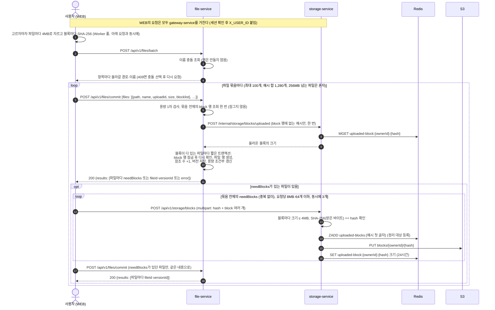
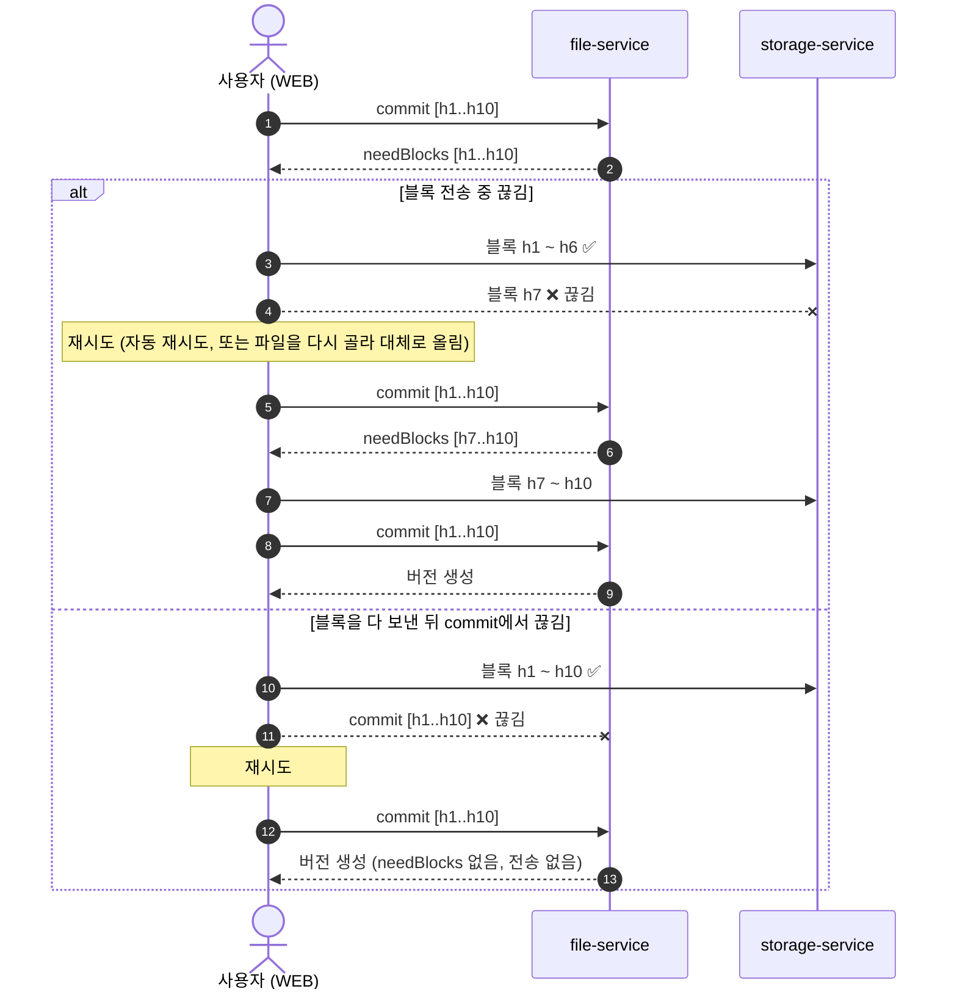
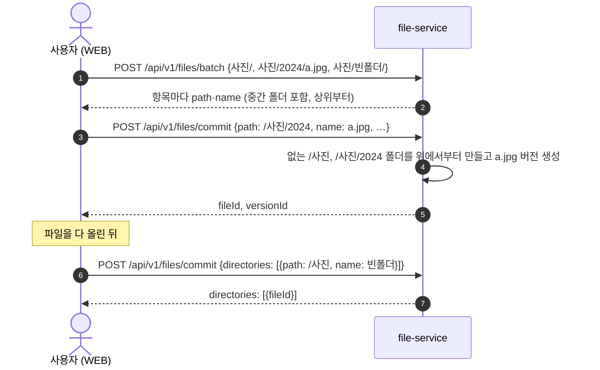

# 파일 업로드 스펙

이 문서는 파일·폴더 업로드가 어떻게 동작하는지 정의합니다.

⚠️ 이 문서가 기준입니다. 코드가 이 문서와 다르면 코드를 고치고, 동작을 바꾸려면 이 문서를 먼저 고칩니다.

---

## 목차

- [1. 구성 요소](#1-구성-요소)
  - [1-1. 블록과 blocklist](#1-1-블록과-blocklist)
  - [1-2. 저장 위치](#1-2-저장-위치)
- [2. 전체 흐름](#2-전체-흐름)
- [3. 충돌 조회 (batch)](#3-충돌-조회-batch)
- [4. 해시 계산과 묶기 (WEB)](#4-해시-계산과-묶기-web)
- [5. commit](#5-commit)
  - [5-1. 버전 생성 규칙](#5-1-버전-생성-규칙)
  - [5-2. 대체 업로드](#5-2-대체-업로드)
  - [5-3. 검증과 오류](#5-3-검증과-오류)
- [6. 블록 전송](#6-블록-전송)
  - [6-1. 저장 순서](#6-1-저장-순서)
  - [6-2. 검증과 오류](#6-2-검증과-오류)
- [7. 이어 올리기](#7-이어-올리기)
- [8. 폴더 업로드](#8-폴더-업로드)
  - [8-1. 폴더 충돌과 병합](#8-1-폴더-충돌과-병합)
- [9. 드라이브 용량 한도](#9-드라이브-용량-한도)
- [10. 동시 요청과 잠금](#10-동시-요청과-잠금)
- [11. 블록 정리](#11-블록-정리)
- [12. 제한값](#12-제한값)
- [13. API 요약](#13-api-요약)

---

## 1. 구성 요소

| 구성 요소 | 역할 |
|---|---|
| **WEB** | 파일을 블록으로 나눠 해시를 계산하고, 서버에 없는 블록만 보낸다 |
| **gateway-service** | 세션을 확인하고 `X_USER_ID`를 붙여 요청을 넘긴다 |
| **file-service** | 이름 충돌 조회, commit(버전 생성), 드라이브 용량 한도, 버전·참조 없는 블록 정리 |
| **storage-service** | 블록 검증·저장(S3), 아직 commit되지 않은 블록 기록(Redis)과 정리 |
| **S3** | 블록 저장 (GZIP 압축 후 AES-GCM 암호화) |
| **Redis** | 올라왔지만 아직 commit되지 않은 블록, 사용자별 블록 업로드 횟수 (storage 전용 Redis, [006 2-4-6](006-resilience-spec.md#2-4-6-redis-분리)) |
| **file_db** | 파일·버전·블록(`block`)·드라이브 용량(`namespace`) |

### 1-1. 블록과 blocklist

- 파일은 **4MB 블록의 SHA-256 해시 목록(blocklist)** 으로 표현한다. 파일 크기에 따라 업로드 방식이 달라지지 않는다.
- WEB이 blocklist로 commit하면 file-service가 서버에 없는 블록만 알려 주고, WEB은 그 블록만 보낸 뒤 같은 목록으로 다시 commit한다.
- 파일 행은 **commit이 버전을 만들 때** 생긴다. 그 전 단계(batch)는 이름 충돌만 조회한다 → 업로드가 끝나지 않은 파일이 목록에 남지 않는다.
- 서버에 업로드 세션이 없다. 다시 commit하는 것이 곧 "어디까지 받았나"를 묻는 것이다 ([7](#7-이어-올리기)).
- 블록은 소유자별로 저장한다(`blocks/{ownerId}/{hash}`). 같은 사용자가 같은 내용을 다시 올리면 전송이 없다.

### 1-2. 저장 위치

**S3**

| 키 | 내용 |
|---|---|
| `blocks/{ownerId}/{hash}` | 블록 하나 (GZIP 압축 → AES-GCM 암호화) |

**Redis** (storage-service)

| 키 | 타입 | 값 | TTL | 용도 |
|---|---|---|---|---|
| `uploaded-block:{ownerId}:{hash}` | string | 블록의 실제 크기 | 24시간 | 올라왔지만 아직 commit되지 않은 블록. commit이 이 값으로 크기를 확인한다 |
| `uploaded-blocks:{0}` ~ `{f}` | sorted set | `ownerId:hash`, 점수 = 올라온 시각 | 없음 | 미커밋 블록 정리 대상 ([11](#11-블록-정리)). 해시 첫 글자로 16개 키에 나눈다 |
| `upload-count:{ownerId}` | string | 블록 업로드 횟수 | 24시간 (첫 업로드부터, 연장 없음) | 사용자당 블록 업로드 한도 ([6-2](#6-2-검증과-오류)) |

**file_db**

| 테이블 | 업로드에서 쓰는 것 |
|---|---|
| `file` | 파일·폴더 행. commit이 버전을 만들 때 생긴다 |
| `file_version` | 버전마다 `file_size`·`upload_id`(unique) |
| `file_version_block` | 버전의 blocklist. 순서(`idx`)마다 해시 한 행 |
| `block` | commit된 블록(소유자·해시)마다 `size`·`ref_count`(이 블록을 가리키는 `file_version_block` 행 수)·`unreferenced_at` |
| `namespace` | 드라이브마다 `used_bytes`·`quota_bytes` ([9](#9-드라이브-용량-한도)) |

---

## 2. 전체 흐름

1. **충돌 조회** — 고른 항목 전체의 이름 충돌을 묻고, 항목마다 실제로 올라갈 경로·이름을 받는다 ([3](#3-충돌-조회-batch)).
2. **해시 계산** — 파일을 고르자마자 WEB이 blocklist를 계산하고, 파일을 묶음으로 나눈다 ([4](#4-해시-계산과-묶기-web)).
3. **commit** — 묶음 전체를 한 번에 보낸다. 블록이 다 있는 파일은 여기서 버전이 생기고, 나머지는 `needBlocks`를 받는다 ([5](#5-commit)).
4. **블록 전송** — `needBlocks`만 storage-service로 보낸다 ([6](#6-블록-전송)).
5. **다시 commit** — `needBlocks`가 있던 파일만 같은 내용으로 다시 보낸다. 빠진 블록이 없으면 버전이 생긴다. 그래도 빠진 블록이 있거나(그 사이 24시간이 지난 경우) 블록 전송이 끝내 실패한 파일은 WEB이 실패로 표시한다.

**설계 메모**

- commit 응답(`fileId`, `versionId`)이 곧 완료다. storage-service가 file-service에 완료를 알리는 콜백은 없다.
- storage-service가 여러 대이거나 재시작돼도 상관없다. 상태가 S3·Redis·file_db에만 있다.

---

## 3. 충돌 조회 (batch)

`POST /api/v1/files/batch`로 고른 항목 전체의 이름 충돌을 확인한다. **행은 만들지 않는다.**

1. **충돌 확인** — 사용자가 아직 고르지 않은 충돌이 있으면 409 `FILE_BATCH_CONFLICT`와 충돌한 이름 목록을 돌려준다.
2. **충돌 선택** — 사용자가 `REPLACE`/`KEEP_BOTH`/`SKIP`을 고르면 WEB이 `resolutions`에 담아 다시 보낸다.
3. **응답** — 200이면 항목마다 아래를 돌려준다. `SKIP`한 항목은 빠진다.
   - `path`·`name`: 실제로 올라갈 경로·이름 (`KEEP_BOTH`면 번호 붙은 이름)
   - `replaced`: 같은 이름의 기존 파일을 대체하면 true, 그 파일의 `fileId`

조회일 뿐이라 그 사이 다른 업로드가 같은 이름을 차지할 수 있다. 그때는 commit이 그 자리의 파일에 새 버전을 올린다.

| 확인 | 실패 |
|---|---|
| 항목 1~5,000개, 항목마다 `relativePath`(255자 이하)·`directory` 있음 | 400 (요청 검증) |
| 네임스페이스 있음 | 404 `NAMESPACE_NOT_FOUND` |
| 올릴 폴더(`path`)가 `/`이거나 호출자 드라이브의 활성 폴더 (공유받은 폴더 불가) | 404 `DIRECTORY_NOT_FOUND` |
| `relativePath`가 겹치지 않고 세그먼트마다 이름 규칙에 맞음, 파일 `size` 0~5GB, 파일로 적은 경로를 다른 항목의 폴더로 쓰지 않음, 번호를 붙인 뒤에도 이름·경로 255자 이하 | 400 `INVALID_BATCH_ITEM` |
| 최상위의 같은 종류 충돌에 `resolutions`가 모두 있음 | 409 `FILE_BATCH_CONFLICT` + `conflicts` |

---

## 4. 해시 계산과 묶기 (WEB)

1. **블록 나누기** — 파일마다 4MB씩 자르고(마지막 블록만 작음) 블록마다 SHA-256을 계산한다(`crypto.subtle.digest`). 순서대로 늘어놓은 해시가 그 파일의 blocklist다.
2. **바로 시작** — **파일을 고르자마자** 계산을 시작한다. batch 요청과 충돌 선택 대화상자를 기다리는 동안 해시가 계산되어, 그 시간이 통째로 숨는다.
3. **Worker 풀** — 해시는 **Web Worker 풀**(코어 수만큼, 최대 8개)에서 계산한다. 블록 16개(64MB)씩 나눠 여러 Worker에 돌리므로 큰 파일도 코어 수만큼 빨라지고 화면이 멈추지 않는다. Worker 하나는 블록 하나만 메모리에 둔다.
4. **묶기** — 파일을 **묶음**(최대 100개, blocklist 길이 합 1,280개 이하)으로 나눈다. **256MB(블록 64개)를 넘는 파일은 혼자 한 묶음**이다. 묶음 안의 파일은 블록 전송이 다 끝나야 같이 완료되므로, 작은 파일이 큰 파일의 전송을 기다리지 않게 한다.

- 고른 순서대로 계산하므로, 앞 묶음을 보내는 동안 뒤 묶음의 해시가 계속 계산된다. 큰 파일은 해시가 끝나기 전 상태 패널에 "준비 중 37%"처럼 진행률을 보여 준다.
- 파일을 읽지 못하면(도중에 삭제됨, 권한 없음) 그 파일만 실패하고 나머지는 그대로 올린다.

---

## 5. commit

`POST /api/v1/files/commit`에 묶음의 파일 전부를 한 번에 보낸다. 파일마다 [3](#3-충돌-조회-batch)의 `path`·`name`, `uploadId`(업로드 시도마다 새 UUID), `size`, `blocklist`를 담는다.

1. **용량 1차 검사** — 요청 시작 때 읽은 `used_bytes`로, 들어가지 않을 파일은 블록 전송 없이 바로 거절한다 ([9](#9-드라이브-용량-한도)).
2. **블록 조회** — 묶음 전체에 **한 번씩**만 묻는다. 이미 commit된 블록은 file_db `block` 테이블로, 올라왔지만 아직 commit되지 않은 블록은 storage-service에 묻는다(Redis 표시).
   - storage-service에는 `block` 테이블에 없는 해시가 있을 때만 묻는다. 이미 있는 파일만 올리면 묻지 않는다.
3. **버전 생성** — 블록이 다 있는 파일마다 **따로 짧은 트랜잭션**으로 버전을 만든다 ([5-1](#5-1-버전-생성-규칙)).
4. **응답** — `results`는 요청 순서 그대로, 파일마다 셋 중 하나다.

| 결과 | 뜻 |
|---|---|
| `needBlocks` | 서버에 없는 블록. 이 파일은 아무것도 만들지 않았다 |
| `fileId`·`versionId` | 버전을 만들었다. 블록이 다 있던 파일은 여기서 끝난다 (0바이트 전송) |
| `error` (`status`·`message`) | 이 파일만 실패했다 ([5-3](#5-3-검증과-오류)). 다른 파일에는 영향이 없다 |

**설계 메모**

- 블록 조회는 **DB 트랜잭션 밖에서** 한다. storage-service가 느려도 file-service가 DB 커넥션·잠금을 잡고 기다리지 않는다 ([006 2-4](006-resilience-spec.md#2-4-s3-호출-storage-service)).
- storage-service 조회가 실패하면(서킷 열림, 시간 초과) 요청 전체를 실패시키지 않는다. 이미 commit된 블록만으로 된 파일은 버전을 만들고, 나머지 파일만 503을 `error`로 답한다.
- commit은 호출자 자신의 드라이브에만 쓴다. 공유받은 폴더로는 올릴 수 없다.

### 5-1. 버전 생성 규칙

파일 하나의 트랜잭션 안에서 아래 순서로 한다.

1. **블록 잠금** — `block` 행을 잠가(정리 작업이 지우지 못하게) 다시 확인한다. 그 사이 정리 작업이 블록을 지웠으면 그 블록을 `needBlocks`로 답한다.
2. **파일 행** — 그 경로·이름에 파일이 있으면 그 파일의 새 버전이 된다(대체). 없으면 파일 행을 새로 만든다. 만들거나 대체한 파일은 최근 문서함에 기록한다.
3. **참조 수** — 버전이 쓰는 블록마다 `ref_count`를 1 올린다.
4. **버전 저장** — `file_version` 행을 넣는다.
5. **용량 확정** — 마지막 문장으로 `used_bytes`를 조건부 갱신한다 ([9](#9-드라이브-용량-한도)).

| 경우 | 동작 |
|---|---|
| **같은 `uploadId`로 이미 버전이 있음** | 그 버전을 그대로 돌려준다. 응답이 유실된 commit을 다시 보내도 버전이 둘 생기지 않는다 (`file_version.upload_id` unique) |
| 같은 commit 두 개가 동시에 옴 | 진 쪽이 유니크 제약(파일 자리·`upload_id`)에 걸리면 이긴 쪽 버전을 답한다 |
| **현재 버전과 내용(`size`·`blocklist`)이 같음** | 새 버전을 만들지 않고 현재 버전을 답한다. 바뀌지 않은 파일을 다시 올려도 버전과 블록 참조가 쌓이지 않는다 |
| 빈 파일 | 블록 없이(`blocklist: []`) commit 한 번으로 끝난다 |

### 5-2. 대체 업로드

이름 충돌에서 대체를 고르면 batch가 기존 파일의 `path`·`name`을 그대로 돌려주고, commit이 그 파일의 새 버전을 만든다.

- 이전 버전과 같은 블록은 이미 있으므로 **바뀐 블록만** `needBlocks`로 나온다. 내용이 같으면 0바이트 전송이다.
- 이전 버전은 그대로 남고 블록을 공유한다. 새 버전이 commit되기 전까지는 이전 버전이 열린다.
- 이전 버전은 [11](#11-블록-정리)의 보존 규칙(30일·최신 100개)에 따라 정리된다.

**한계** — 블록 경계가 고정 4MB라서 **앞쪽에 바이트를 끼워 넣으면** 뒤 블록이 전부 밀려 다시 올라간다. 덮어쓰기와 뒤에 덧붙이기에서만 이득이 있다(Dropbox도 같은 한계).

### 5-3. 검증과 오류

**요청 전체가 실패**

| 확인 | 실패 |
|---|---|
| 네임스페이스 있음 | 404 `NAMESPACE_NOT_FOUND` |
| 파일 0~100개, 폴더 0~1,000개, 합쳐 1개 이상, 해시 형식(소문자 hex 64자), 파일 하나의 해시 1,280개 이하 | 400 (요청 검증) |
| 묶음 전체의 해시 합 1,280개 이하 | 400 `COMMIT_TOO_LARGE` |

**그 파일만 실패** (`results[i].error`)

| 확인 | 실패 |
|---|---|
| `path`가 `/` 또는 정규형 절대 경로, `name`이 이름 규칙에 맞음, 둘 다 255자 이하 | 400 `INVALID_BATCH_ITEM` |
| `uploadId`로 만든 버전이 있다면 호출자의 것이고 `size`·`blocklist`도 같음 | 400 `INVALID_BLOCKLIST` |
| `size` ≤ 5GB | 413 `FILE_TOO_LARGE` |
| 드라이브 사용량 + 이 파일이 늘리는 크기 ≤ 용량 한도 ([9](#9-드라이브-용량-한도)) | 413 `QUOTA_EXCEEDED` (WEB은 그 행에 "저장 공간 부족" 표시) |
| `blocklist` 길이 = `ceil(size / 4MB)` (빈 파일은 0) | 400 `INVALID_BLOCKLIST` |
| 마지막을 뺀 블록은 모두 정확히 4MB, 마지막은 1바이트~4MB, 합 = `size` (크기는 `block` 행·Redis 표시에 저장된 실제 값) | 400 `INVALID_BLOCKLIST` |
| 그 자리에 폴더가 없고, 상위 경로 중간에 파일이 없음 (버전을 만들 때만) | 400 `FILE_ALREADY_EXISTS` |
| `block` 행에 없는 블록이 있는데 storage-service 조회가 실패함 (서킷 열림·시간 초과·5xx) | 503 |
| Postgres가 잠금 순환(교착)을 끊음 | 503 (다시 보내면 된다) |

---

## 6. 블록 전송

`needBlocks`가 있을 때만 한다. WEB이 묶음 전체의 `needBlocks`를 **중복 없이** 모아(여러 파일에 같은 블록이 있어도 한 번) `POST /api/v1/storage/blocks`로 보낸다.

1. **요청** — 요청 하나에 블록 64개·합계 8MB까지, multipart로 `hash`와 `block`을 같은 순서로 반복한다. WEB은 요청을 **동시에 3개까지** 보낸다.
2. **검증** — storage-service가 블록마다 받은 바이트의 해시를 **다시 계산**해, 함께 온 해시와 다르면 거절한다. 클라이언트가 보낸 해시는 믿지 않는다.
3. **저장** — 요청 하나의 블록을 **전부 확인한 뒤에** 저장한다. 하나라도 잘못되면 아무것도 저장하지 않는다 ([6-1](#6-1-저장-순서)).

**설계 메모**

- 동시 3개는 왕복 시간을 줄이면서 storage-service 업로드 자리([006 2-4-4](006-resilience-spec.md#2-4-4-벌크헤드))를 다른 사용자에게 남기는 값이다.
- storage-service 메모리는 요청당 블록 합 8MB까지 쓴다(multipart 한도 `STORAGE_MULTIPART_MAX_REQUEST_SIZE` 9MB).

### 6-1. 저장 순서

블록마다 **정리 대상 등록(ZADD) → S3 PUT → 업로드 표시(SET)** 순서다.

| 순서 | 이유 |
|---|---|
| 표시(SET)는 반드시 PUT **뒤** | 먼저 하면 S3에 없는 블록으로 commit이 성공해 파일이 깨진다 |
| 정리 대상 등록(ZADD)은 PUT **앞** | PUT 뒤에 하면, PUT은 됐는데 Redis가 실패한 블록이 정리 대상에도 오르지 않아 S3에 영구히 남는다. 등록만 되고 PUT이 실패한 블록은 정리 작업이 없는 객체를 지우는 것으로 끝난다 |

- 같은 블록을 다시 올리면 등록 시각이 지금으로 옮겨져 정리 대상에서 멀어진다. S3 객체는 그냥 덮어쓴다(내용이 같으므로 무해).
- 정리 대상 목록은 해시 첫 글자(hex)로 **16개 키**(`uploaded-blocks:{0}` ~ `{f}`)에 나뉜다. 모든 업로드가 쓰는 목록이라, 키 하나면 Redis 샤드를 늘려도 한 샤드에 쓰기와 메모리가 몰린다.

### 6-2. 검증과 오류

| 확인 | 실패 |
|---|---|
| 해시가 맞고 빈 블록이 아니며 `hash`와 `block` 개수가 같음 | 400 `INVALID_BLOCK` |
| 블록 하나가 4MB 이하 | 413 `BLOCK_TOO_LARGE` |
| 요청 합 8MB 이하, 64개 이하 | 413 `BLOCK_BATCH_TOO_LARGE` |
| S3가 정상이고 동시 업로드 자리가 남음 | 503 `STORAGE_UNAVAILABLE` + `Retry-After` |
| 사용자당 24시간에 블록 25,600개(4MB 기준 100GB) 이하 (`STORAGE_UPLOAD_BLOCKS_PER_WINDOW`) | 429 `UPLOAD_LIMIT_EXCEEDED` |

- 503은 기다리지 않고 바로 답한다. 중간에 실패하면 일부 블록만 저장됐을 수 있지만, 다시 보내면 덮어쓰므로 무해하다.
- 24시간 블록 한도가 없으면 commit하지 않을 블록으로 S3와 Redis를 무한히 채울 수 있다. 드라이브 용량 한도는 이와 별개로 commit이 검사한다.

---

## 7. 이어 올리기

서버에 업로드 세션이 없다. **다시 commit하는 것이 곧 "어디까지 받았나" 조회**다.

**WEB의 재시도**

| 실패 | WEB의 동작 |
|---|---|
| 네트워크 오류, 5xx | 1초/2초/4초 간격으로 3번 다시 보낸다. 간격마다 0~50% 지터를 더해 S3가 복구되는 순간 모든 클라이언트가 같은 박자로 몰리지 않게 한다. 503에 `Retry-After`(10초, 서킷이 열려 있는 시간)가 오면 그보다 일찍 보내지 않는다 |
| 3번 다 실패 | 바로 실패로 끝내지 않고 **일시 중지**한다. 상태 패널에 "연결 대기 중 · 자동으로 다시 시도합니다"로 보이고, 30초마다(지터 포함) 다시 보내다 성공하면 이어 간다. 10분이 지나도 안 되면 그 묶음의 남은 파일을 실패로 표시한다 |
| 블록 요청의 400·413 | 해시를 계산한 뒤 파일이 바뀐 경우 등. 그 요청의 블록이 필요한 파일만 실패시키고 나머지 요청은 계속 보낸다 |
| 그 밖의 4xx (429 24시간 한도, 401 세션 만료 등) | 어느 요청이든 같은 결과라 나머지 블록 전송과 일시 중지 중이던 요청을 멈춘다. 다시 보내지 않는다 |

- 탭이 열려 있는 동안은 고른 `File`이 살아 있어서 다시 고를 필요가 없다.
- 끝내 실패한 파일을 다시 고르면 해시를 다시 계산하고 commit한다. 이미 받은 블록은 건너뛰고, 블록을 다 받은 상태였다면 그 commit 한 번으로 버전이 생긴다. WEB이 `localStorage`에 기억할 것이 없다.
- 올라온 블록은 **24시간** 안에 commit해야 한다. 그 뒤에는 Redis 표시가 사라져 `needBlocks`에 다시 나온다.

---

## 8. 폴더 업로드

폴더를 고르면(또는 끌어다 놓으면) 그 안의 파일 전체가 [2](#2-전체-흐름)의 흐름으로 올라간다. 파일을 commit할 때 없는 상위 폴더가 같이 생기고, 파일이 없는 폴더만 마지막 commit에 `directories`로 보낸다.

1. **충돌 조회** — batch에 폴더와 그 안의 파일을 상대 경로로 모두 보낸다.
   - 최대 5,000개. 넘으면 WEB이 보내기 전에 "한 번에 5,000개까지"로 안내하고, 나눠 보내지 않는다.
   - 응답에는 요청에 없던 **중간 폴더도 상위부터** 들어 있다.
   - 충돌은 **최상위 항목만** 묻는다. 그 아래는 새로 만들 폴더 안이라 겹칠 수 없다 ([8-1](#8-1-폴더-충돌과-병합)).
2. **파일 commit** — [5](#5-commit) 그대로다. 버전을 만들 때 `path`의 폴더가 없으면 **위에서부터** 만들고, 같은 묶음의 다음 파일은 그 폴더를 그대로 쓴다. 상위 경로 중간에 같은 이름의 **파일**이 있으면 그 파일만 400 `FILE_ALREADY_EXISTS`로 실패한다.
3. **남은 폴더** — 빈 폴더나 안의 파일이 전부 실패한 폴더는 파일 commit으로 생기지 않는다. WEB이 파일을 다 올린 뒤, 1번 응답의 폴더 중 아직 없는 것을 commit의 `directories`(`path`·`name`, 요청당 1,000개까지)로 한 번에 보낸다.
   - 파일과 같은 규칙이다. 없는 상위 폴더를 위에서부터 만들고, 이미 있는 폴더면 그 `fileId`를 답한다. 그래서 순서나 부모 생성 실패를 따로 신경 쓸 필요가 없다.
   - 응답 `directories`는 요청 순서대로 폴더마다 `fileId` 또는 `error`다. 경로·이름이 규칙에 어긋나면 400 `INVALID_BATCH_ITEM`, 그 자리나 상위 경로에 파일이 있으면 400 `FILE_ALREADY_EXISTS`로 그 폴더만 실패한다.
   - `replaced: true`인 폴더(병합 대상)는 이미 있으므로 보내지 않는다.

파일 일부가 실패해도 이미 commit된 파일과 그 폴더들은 남는다.

### 8-1. 폴더 충돌과 병합

**최상위 폴더가 같은 이름의 폴더와 겹칠 때**

| 선택 | 동작 |
|---|---|
| `REPLACE` (대체) | 기존 폴더에 **병합**한다. 기존 폴더를 지우지 않으므로 폴더 ID·공유 설정이 그대로다. 응답의 그 폴더는 `replaced: true`와 기존 `fileId` |
| `KEEP_BOTH` | `사진 (1)`처럼 번호를 붙인 새 폴더로 올린다. 하위 항목의 경로도 바뀐 이름을 따라간다 |
| `SKIP` | 그 폴더와 하위 전체를 뺀다 |

최상위에서 폴더와 파일처럼 종류가 다르게 겹치면 묻지 않고 번호를 붙인다.

**병합되는 폴더 안의 항목** (하위 폴더로 재귀)

| 올린 항목 | 그 폴더에 이미 있는 것 | 동작 |
|---|---|---|
| 파일 | 같은 이름 파일 | 묻지 않고 **새 버전** (`replaced: true`) |
| 폴더 | 같은 이름 폴더 | 묻지 않고 **다시 병합** |
| 파일 ↔ 폴더 (종류가 다름) | | **번호 붙임** |
| 무엇이든 | 없음 | 새로 만듦 |

올린 쪽에 없는 기존 항목은 지우지 않는다.

---

## 9. 드라이브 용량 한도

| 항목 | 값 |
|---|---|
| 사용량 | `namespace.used_bytes` (폴더 제외, 휴지통 포함, 영구 삭제 제외). 사용량 화면도 이 값을 보여 준다 |
| 한도 | `namespace.quota_bytes` (기본 20GB, `MODUDRIVE_FILE_DEFAULT_QUOTA_BYTES`) |

**사용량이 바뀌는 때**

| 작업 | `used_bytes` |
|---|---|
| 새 파일 commit | 파일 크기만큼 더함 |
| 대체 commit | 기존 파일 크기를 뺀, 늘어나는 만큼만 더함 (줄어들면 뺌) |
| 영구 삭제 | 그 파일 크기만큼 뺌 |
| 휴지통 이동·복원 | 바꾸지 않음 |

**검사는 두 번 한다**

1. **1차 검사** — 블록을 묻기 전에, 요청 시작 때 읽은 `used_bytes`로 한다. 들어가지 않을 파일은 블록 전송 없이 첫 commit에서 거절한다.
2. **확정** — 버전을 만드는 트랜잭션의 **마지막 문장**인 조건부 갱신(`used_bytes + 늘어나는 크기 ≤ quota_bytes`일 때만 더함)이 한다. 늘어나는 크기는 대상 파일 행을 잠근 뒤 다시 계산한다.

- 사용량을 늘리지 않는 파일(같거나 작아지는 대체)은 한도를 넘은 드라이브에서도 통과한다. 대신 줄어드는 만큼을 같은 묶음의 다른 파일에 내주지 않는다.
- 묶음 안에서는 앞 파일부터 차례로 센다. 넘치는 파일만 실패하고, 들어가는 뒤 파일은 계속 간다.

**설계 메모**

- 같은 드라이브에 동시에 들어온 commit은 namespace 행 잠금에서 줄을 서고, 뒤의 commit은 앞 commit이 더한 값으로 다시 검사한다. 1차 검사를 같이 통과한 두 commit도 한도를 넘지 못한다.
- 진 쪽은 트랜잭션 전체가 롤백되고 그 파일만 413 `QUOTA_EXCEEDED`로 실패한다. 이미 올라간 블록은 [11](#11-블록-정리)의 미커밋 블록 정리가 지운다.

---

## 10. 동시 요청과 잠금

commit, 휴지통 이동, 복원, 이름 변경, 이동, 영구 삭제가 같은 행을 건드려도 서로 덮어쓰거나 교착에 빠지지 않도록 잠그는 순서를 맞췄다.

| 작업 | 잠그는 순서 |
|---|---|
| commit | 블록(해시 순) → 상위 폴더부터 대상 파일까지(위에서부터) → namespace (마지막) |
| 휴지통·복원·이름 변경·이동 | 대상 행 → 하위 전체 (경로·이름 순) |
| 영구 삭제 | 대상 행 → 휴지통에 있는 하위 행 (경로·이름 순) → 블록 (소유자·해시 순) → namespace (마지막 한 번) |

**작업이 겹칠 때**

| 겹치는 작업 | 결과 |
|---|---|
| 휴지통 이동이 진행 중인 commit을 기다림 | 그 결과(새 현재 버전, 새 파일)까지 휴지통으로 보낸다. 먼저 읽은 옛 현재 버전을 덮어쓰지 않고, 휴지통에 간 폴더 아래 활성 파일이 남지 않는다 |
| commit이 휴지통 이동을 기다림 | 그 행은 더 이상 활성이 아니므로, 같은 자리에 새 폴더·파일을 만든다 |
| 영구 삭제와 복원 | 영구 삭제는 대상을 잠근 뒤 다시 읽어 여전히 같은 휴지통 항목일 때만 지운다. 행을 tombstone으로 바꾼 뒤(여전히 `TRASHED`였을 때만) 버전·공유·즐겨찾기를 지워서, 그 사이 복원된 파일은 아무것도 잃지 않는다 |
| Postgres가 잠금 순환을 끊음 | 그 파일(`directories`면 그 폴더)만 503으로 실패한다. 다시 보내면 된다 |

**설계 메모**

- 영구 삭제는 하위 중 휴지통에 있는 행만 잠근다. 같은 경로를 다시 쓰는 살아 있는 폴더까지 잠그면 commit과 순서가 엇갈리기 때문이다.
- 폴더 이동·휴지통·복원·영구 삭제는 하위 행을 하나씩 처리하지 않고 경로 접두사 벌크 SQL로 처리한다 ([perf-test 001](../perf-test/001-folder-cascade.md)).
- 저장은 바뀐 컬럼만 쓴다(`@DynamicUpdate`). 그 사이 commit이 바꾼 현재 버전·크기를 옛 값으로 되돌리지 않는다.
- file-service는 open-in-view를 끈다. 켜 두면 요청 하나가 EntityManager를 공유해, 잠그고 다시 읽어도 앞서 캐시된 옛 상태를 본다.

---

## 11. 블록 정리

정리 작업 셋이 모두 1시간마다 돈다. 버전 정리가 블록 참조를 풀고, 참조 없는 블록 정리와 미커밋 블록 정리가 실제 블록을 지운다.

| 정리 | 어디서 | 대상 | 여러 인스턴스일 때 |
|---|---|---|---|
| 보존 기간이 지난 버전 | file-service | `UPLOADED` 파일에서 현재 버전이 아니면서, 만든 지 30일이 지났거나 그 파일의 최신 100개 밖인 `file_version` 행 | ShedLock으로 한 인스턴스만 |
| 참조 없는 블록 | file-service | `block.ref_count`가 0이 된 지 24시간 지난 행 | `FOR UPDATE SKIP LOCKED`로 나눠 처리 |
| commit되지 않은 블록 | storage-service | 올라온 지 25시간 지난 `uploaded-blocks:{0..f}` 항목 (16개 키를 차례로) | Redis에서 블록마다 원자적으로 가져가 나눠 처리 |

1. **보존 기간이 지난 버전** — commit과 같은 순서로 블록(해시 순) → 파일 행을 잠그고, 다시 읽어 그 버전들의 블록 참조를 풀고 행을 지운다. 파일마다 트랜잭션 하나.
   - 이 규칙이 없으면 덮어쓸 때마다 이전 블록이 파일이 영구 삭제될 때까지 S3에 남는다.
   - 휴지통 파일의 버전은 영구 삭제 때 같이 지워진다.
2. **참조 없는 블록** — 버전을 지우면 그 블록들의 `ref_count`를 빼고, 0이 되는 순간 `unreferenced_at`을 찍는다.
   - 24시간 안에 같은 블록이 다시 commit되면 살아난다(휴지통을 비운 직후 같은 파일을 다시 올리는 경우).
   - 지나면 행을 지우고 같은 트랜잭션에서 `storage-blocks-purge-requested`(outbox)를 기록한다 → storage-service가 S3 객체를 지운다 ([005 7](005-messaging-spec.md#7-사용-큐-목록)).
3. **commit되지 않은 블록** — 지우기 전에 file-service(`POST /internal/files/blocks/committed`)에 commit됐는지 물어 commit된 블록은 남긴다.

**설계 메모**

- storage-service는 S3 객체를 지울 때 결정 시각(`decidedAt`) 뒤에 다시 쓰인 블록은 남긴다. `HeadObject`의 `LastModified`(초 단위)를 결정 시각과 비교하고, `DeleteObject`에 `If-Match: <ETag>`를 붙여 그 사이 덮어쓰인 객체는 412로 남는다.
- 블록 해제는 모든 버전의 해시를 합쳐 **해시 순서로** 한다. commit이 블록 행을 잠그는 순서와 같아서, 같은 블록을 쓰는 commit과 영구 삭제가 교착에 빠지지 않는다.
- 폴더 영구 삭제는 하위 파일 전부의 블록 참조를 SQL 안에서 모아 한 번에 푼다.
- 행이 없는 블록을 해제하면 오류 로그를 남긴다(참조 수가 어긋났다는 뜻).

---

## 12. 제한값

| 항목 | 값 | 위치 |
|---|---|---|
| 블록 크기 | 4MB | `STORAGE_BLOCK_SIZE`, WEB 상수 |
| 파일 크기 | 5GB | `UploadBatchService.MAX_FILE_SIZE_BYTES` |
| 드라이브 용량 (기본) | 20GB | `MODUDRIVE_FILE_DEFAULT_QUOTA_BYTES` |
| batch 항목 수 | 5,000개 | `UploadBatchRequest` |
| commit 한 번 | 파일 100개, 폴더 1,000개, 해시 합 1,280개 | `CommitFileUploadRequest`, `COMMIT_TOO_LARGE` |
| 혼자 한 묶음이 되는 파일 | 256MB(블록 64개) 초과 | WEB `SOLO_BLOCKS` |
| 블록 전송 요청 하나 | 64개, 합 8MB | `UploadBlocksService.MAX_BLOCKS_PER_REQUEST`, `MAX_BYTES_PER_REQUEST` |
| 블록 전송 동시 요청 | 3개 | WEB `PARALLEL_BLOCK_REQUESTS` |
| 사용자당 블록 업로드 | 24시간에 25,600개 | `STORAGE_UPLOAD_BLOCKS_PER_WINDOW` |
| 미커밋 블록 유효 기간 | 24시간 (정리는 25시간 뒤) | `Blocks.UPLOAD_TTL`, `PurgeUncommittedUploadsService.MARGIN` |
| 해시 Worker | 코어 수, 최대 8개 | WEB `hash-in-worker.ts` |
| 재시도 | 1·2·4초 3번 → 30초마다, 최대 10분 | WEB `upload-file.ts` |
| 버전 보존 | 30일, 최신 100개 | `PruneFileVersionsService.RETENTION`, `KEEP` |
| 참조 없는 블록 유예 | 24시간 | `PurgeUnreferencedBlocksService.GRACE` |

---

## 13. API 요약

| 메서드 · 경로 | 서비스 | 인증 | 용도 |
|---|---|---|---|
| `POST /api/v1/files/batch` | file | 세션 | 이름 충돌 조회, 올라갈 경로·이름 |
| `POST /api/v1/files/commit` | file | 세션 | 파일 버전 생성 / `needBlocks`, 빈 폴더 생성 |
| `POST /api/v1/storage/blocks` | storage | 세션 | 블록 전송 (multipart) |
| `POST /internal/storage/blocks/uploaded` | storage | 서비스 간 | 올라왔지만 commit되지 않은 블록의 크기 |
| `POST /internal/files/blocks/committed` | file | 서비스 간 | commit된 블록인지 (미커밋 블록 정리가 지우기 전에 확인) |

**호출 수** (batch 1번 제외)

| 경우 | 파일마다 따로 올릴 때 | 묶음 |
|---|---|---|
| 새 작은 파일 1,000개 (각 10KB) | 약 3,000번 | commit 10 + 블록 2 + commit 10 = 약 22번 |
| 새 30MB 파일 1개 | commit 2 + 블록 8 = 10번 | commit 2 + 블록 4 = 6번 |
| 이미 있는 파일 100개 | commit 100번 | commit 1번 |
| 빈 폴더 1,000개 | 폴더 생성 1,000번 | commit 1번 ([8](#8-폴더-업로드)) |
