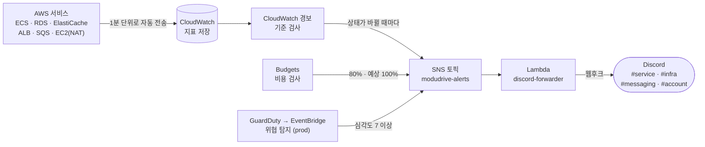

# 디스코드 알림 스펙

서비스에 문제가 생겼을 때 알림이 디스코드 채널까지 어떻게 전달되는지 정리한 문서입니다.

⚠️ 이 문서가 기준입니다. 코드가 이 문서와 다르면 코드를 고치고, 동작을 바꾸려면 이 문서를 먼저 고칩니다.

---

## 목차

- [1. 알림 발송 과정](#1-알림-발송-과정)
  - [1-1. 알림이 오기까지 걸리는 시간](#1-1-알림이-오기까지-걸리는-시간)
- [2. 알림 설정](#2-알림-설정)
  - [2-1. 지표](#2-1-지표)
  - [2-2. 규칙](#2-2-규칙)
  - [2-3. 알림 메시지](#2-3-알림-메시지)
  - [2-4. 그룹핑과 재발송](#2-4-그룹핑과-재발송)
- [3. 사용 디스코드 채널](#3-사용-디스코드-채널)
- [4. 사용 알림](#4-사용-알림)
  - [4-1. 이벤트 전송 적체](#4-1-이벤트-전송-적체)
  - [4-2. 이벤트 전송 실패](#4-2-이벤트-전송-실패)
  - [4-3. 이벤트 처리 실패](#4-3-이벤트-처리-실패)
  - [4-4. 서비스 응답 없음](#4-4-서비스-응답-없음)
  - [4-5. 서킷 열림](#4-5-서킷-열림)
  - [4-6. 요청 실패율 높음](#4-6-요청-실패율-높음)
  - [4-7. 느린 요청 많음](#4-7-느린-요청-많음)
  - [4-8. 힙 메모리 부족](#4-8-힙-메모리-부족)
  - [4-9. DB 커넥션 부족](#4-9-db-커넥션-부족)
- [5. AWS 전용 경보](#5-aws-전용-경보)
  - [5-1. 발송 과정](#5-1-발송-과정)
  - [5-2. 알림이 오기까지 걸리는 시간](#5-2-알림이-오기까지-걸리는-시간)
  - [5-3. 알림 메시지](#5-3-알림-메시지)
  - [5-4. 경보 목록](#5-4-경보-목록)
- [6. TODO](#6-todo)

---

## 1. 알림 발송 과정

각 서비스는 자기 상태를 숫자로 내놓는다. 예를 들어 "아직 못 보낸 이벤트가 몇 초째 밀려 있다", "서킷이 열려 있다" 같은 것이다.
이 숫자를 **지표**라고 부른다. Prometheus가 지표를 모아 두고 규칙으로 검사하다가, 이상하면 Alertmanager가 디스코드 웹후크로 보낸다.
로컬과 demo가 같은 길을 쓴다. demo는 Prometheus·Alertmanager 자리에 Grafana Cloud가 있다([003-aws-migration.md 1-13](../guide/003-aws-migration.md#1-13-모니터링과-알림)).


| 단계 | 하는 일 |
|---|---|
| 각 서비스 | `:9464/actuator/prometheus` 주소에 지표를 내놓는다 |
| collector | 60초마다 모든 서비스의 지표를 가져가 Prometheus로 보낸다 (demo와 같다. prod는 30초) |
| Prometheus | 지표를 저장한다. AWS는 그 자리에 demo는 Grafana Cloud, prod는 AMP가 있다 |
| 알림 규칙 | Prometheus가 1분마다 "이 값이 기준을 넘었나"를 확인한다. 정해 둔 시간(`for`) 동안 계속 넘어야 알림을 보낸다 |
| Alertmanager | 비슷한 알림을 한 메시지로 묶고 디스코드 문구로 만들어, 규칙의 `channel` 라벨에 맞는 웹후크로 보낸다. 고칠 때까지 4시간마다 다시 보낸다 |
| Discord | 알림에 적힌 채널(`#service`, `#infra`, `#messaging`)로 도착한다([3장](#3-사용-디스코드-채널)) |

### 1-1. 알림이 오기까지 걸리는 시간

문제가 생겨도 알림은 바로 오지 않는다. 문제가 생긴 뒤 🚨 알림이 오기까지는 아래 단계를 차례로 거친다.

| 순서 | 걸리는 시간 | 이유 |
|---|---|---|
| 1. 지표 수집 | 최대 60초 (prod 30초) | collector가 60초마다 가져간다. AWS는 `otel_collector.scrape_interval`(`envs/*.tfvars`)을 따른다 |
| 2. 발견 | 최대 1분 | 규칙을 1분마다 검사한다. 처음 발견하면 "대기(Pending)" 상태가 된다 |
| 3. 지속 확인 | `for` (알림마다 다름) | 이 시간 동안 계속 문제여야 "발생(Firing)"이 된다. 중간에 한 번이라도 괜찮아지면 처음부터 다시 센다 |
| 4. 발송 대기 | 30초 | 같이 묶을 알림이 더 있는지 잠깐 기다렸다 보낸다 |

예를 들어 서킷 열림은 `for`가 2분이라, 서킷이 열리고 2분 반에서 4분 반 사이에 알림이 온다.

문제가 사라진 뒤 ✅ 해제 알림이 오기까지는 이렇다.

| 순서 | 걸리는 시간 | 이유 |
|---|---|---|
| 1. 지표 수집 | 최대 60초 | 위와 같다 |
| 2. 발견 | 최대 1분 | 다음 검사에서 괜찮아진 걸 보면 바로 해제한다. 해제할 때는 `for`만큼 기다리지 않는다 |
| 3. 발송 대기 | 최대 1분 | 이미 보낸 알림은 1분 간격으로만 다시 보낼 수 있다([2-4](#2-4-그룹핑과-재발송)) |

보통 고치고 2분 안에 해제 알림이 온다. 여기서 "고친 시점"은 지표 값이 실제로 바뀐 때다.
서킷은 상대 서비스가 살아나도 요청이 한 번 와야 닫히기 때문에, 요청이 없으면 해제가 더 늦어진다([4-5](#4-5-서킷-열림)).

---

## 2. 알림 설정

알림을 고치거나 새로 만들 때 보는 장이다. 알림 하나는 네 가지로 정해진다.

1. 무엇을 볼지 (지표)
2. 언제 울릴지 (규칙)
3. 무슨 내용을 보낼지 (메시지)
4. 어떻게 묶어서 보낼지 (그룹핑)

| 파일 | 내용 | AWS 쪽 짝 |
|---|---|---|
| `.docker/observability/alert-rules.yaml` | 규칙 (2-1, 2-2) | `.infra/monitoring/alert-rules.yaml` |
| `.infra/monitoring/discord.tmpl` | 메시지 양식 (2-3) | 같은 파일 |
| `.docker/observability/alertmanager.yml` | 그룹핑·채널 (2-4, 3장) | demo `.infra/monitoring/alertmanager-grafana-cloud.yaml`, prod `.infra/monitoring/alertmanager.yaml` |
| `.infra/monitoring/discord_forwarder.py` | AWS 전용 경보의 SNS → 디스코드 전달 ([5장](#5-aws-전용-경보)) | 로컬엔 없음 |

규칙 파일은 로컬과 AWS가 따로다. 쿼리와 기준값은 같고 확인 명령어만 다르다(docker ↔ ECS, 로그·trace는 demo가 로컬과 같은 Loki·Tempo, prod가 CloudWatch·X-Ray). 규칙을 고치면 두 파일을 같이 고친다.
예외는 둘이다. AWS는 서비스마다 태스크가 여럿일 수 있어 서비스 응답 없음·힙 메모리 부족을 `by (service, instance)`로 태스크마다 따로 보고, 서비스 태스크 없음([4-4](#4-4-서비스-응답-없음))이 하나 더 있다.

### 2-1. 지표

서비스가 내놓는 지표 한 줄은 **이름, 라벨, 값**으로 되어 있다.

```
modudrive_outbox_failed{service="member-service",queue="mail-verification-requested",reason="QueueDoesNotExistException",detail="The specified queue does not exist."} 1
```

- 이름: `modudrive_outbox_failed` (전송에 실패한 이벤트 수)
- 라벨: 중괄호 안의 값들. 어느 서비스의 어느 큐에서 왜 실패했는지를 나타낸다
- 값: 맨 끝의 `1` (1건)

규칙은 이 지표를 PromQL이라는 조회 문법으로 읽는다.

```
max by (service, queue, reason, detail) (modudrive_outbox_failed) > 0
```

지표나 규칙을 만들 때 지킬 것이 있다.

- **`by (...)` 안에 적은 라벨만 알림 메시지에 쓸 수 있다.** 여기서 빠진 라벨은 조회 결과에 남지 않는다.
- **라벨 값은 짧고 가짓수가 적어야 한다.** 라벨 값이 하나 달라질 때마다 Prometheus는 따로 저장하고, 알림도 따로 만든다.
  그래서 요청 ID나 바이트 수처럼 매번 바뀌는 값은 라벨에 넣지 않는다.
- `service` 라벨은 서비스가 내놓는 게 아니라 collector가 붙인다(로컬은 스크레이프 주소, AWS는 컨테이너 이름). 메시지의 "대상"은 이 라벨이나 게이트웨이 경로(`routeId`)다.
- 라벨 조합이 사라지면 그 알림은 해제된다. 예를 들어 FAILED 행을 고쳐서 그 큐의 실패가 0건이 되면 해당 지표가 없어지고, 알림이 풀린다.

### 2-2. 규칙

`alert-rules.yaml`의 `rules:` 아래 항목 하나가 알림 하나다.

```yaml
- alert: OutboxFailed                        # 알림 이름 (영문)
  expr: max by (service, queue, reason, detail) (modudrive_outbox_failed) > 0   # 볼 지표와 기준 (2-1)
  for: 0m                                    # 이 시간 동안 계속 문제여야 보낸다 (없으면 0m)
  labels: {channel: messaging}               # 보낼 채널 (3장)
  annotations: {title: 이벤트 전송 실패, summary: ..., action: ..., query: ...}   # 메시지에 들어갈 문구 (2-3)
```

새 알림을 만들 때 가장 고민할 것은 `for`다.

- **기다리면 저절로 풀릴 수 있는 문제**는 몇 분을 준다. 재배포나 잠깐의 네트워크 끊김까지 알리면, 정작 중요한 알림이 묻힌다.
- **사람이 손대야만 풀리는 문제**는 `0m`으로 바로 보낸다. 기다려도 나아지지 않기 때문이다.

조건이 다시 정상으로 돌아오면 같은 채널로 ✅ 해제 알림이 간다. 다만 규칙은 숫자만 볼 뿐이라, 사람이 제대로 고쳤는지까지는 알지 못한다.

### 2-3. 알림 메시지

기본 메시지는 값을 전부 늘어놓아서 필요한 내용이 잘 안 보인다. 그래서 메시지 양식(`discord.tmpl`)을 직접 만들었다. 로컬과 AWS가 같은 파일을 쓴다.
새벽에 휴대폰으로 봐도 바로 알아볼 수 있는 것이 기준이다.

```
🚨 서킷 열림

대상: gateway-service · `memberServiceCircuitBreaker`

사유: 2분째 닫히지 않음 — 대상 서비스 호출이 계속 실패 중 (502·503·504 · 타임아웃 · 연결 실패)
조치: 서킷이 부르는 서비스의 상태와 로그로 실패 원인 확인
확인 명령어
  docker logs modudrive-service-gateway-service-1 2>&1 | grep "memberServiceCircuitBreaker"
```

메시지에 넣을 수 있는 내용은 두 가지다.

| 내용 | 어디서 오나 |
|---|---|
| 서비스, 큐, 서킷 이름 | 지표의 라벨. `by (...)`에 넣은 것만 쓸 수 있다([2-1](#2-1-지표)) |
| 제목, 사유, 조치, 확인 명령어, 조회·복구 SQL 등 | 규칙의 `annotations`에 적어 둔 문구 |

본문 아래에는 Alertmanager가 제목 카드(embed, `discord.title`)를 붙인다. 발생은 빨간색, 해제는 초록색이라 채널을 훑어볼 때 상태가 바로 보인다.
링크는 넣지 않는다. 알림 상태와 일시 중지는 Grafana의 Alerting 화면에서 본다(로컬 `http://localhost:3001`, demo는 Grafana Cloud).

양식을 고칠 때 알아 둘 것이 있다.

- 같은 알림이 여러 건 동시에 생기면 한 메시지로 묶인다([2-4](#2-4-그룹핑과-재발송)). 이때는 위 예시처럼 다 쓰지 않고,
  건마다 "대상 — 사유"를 한 줄씩만 쓴다. 건마다 명령어까지 달면 몇 건만 모여도 디스코드 글자 수 제한(2000자)을 넘기 때문이다.
  Alertmanager도 2000자에서 자른다.
- 디스코드는 줄바꿈 한 번을 같은 문단으로 이어 붙인다. 항목 사이는 빈 줄로 띄운다.
  단, 코드 블록 뒤에는 디스코드가 여백을 알아서 넣기 때문에 빈 줄을 넣지 않는다.
- 명령어는 조치 문장 속에 섞지 않고 따로 코드 블록으로 뺀다. 휴대폰에서 길게 눌러 바로 복사할 수 있다.

### 2-4. 그룹핑과 재발송

알림이 한꺼번에 여러 개 생겼을 때 몇 통으로 나눠 보낼지, 얼마나 자주 다시 보낼지를 정한다.

| 설정 | 값 | 뜻 |
|---|---|---|
| `group_by` | `alertname` | 알림 이름이 같으면 한 메시지로 묶는다. 서비스 세 개가 동시에 죽으면 "서비스 응답 없음 (3건)" 한 통이 온다 |
| `group_wait` | 30초 (Alertmanager 기본값) | 처음 보낼 때 같이 묶을 알림이 더 있는지 30초 기다린다 |
| `group_interval` | 1분 | 이미 보낸 묶음은 1분 간격으로만 다시 보낸다. 해제 알림도 이 간격을 따른다 |
| `repeat_interval` | 4시간 | 고치지 않으면 4시간마다 다시 알린다 |

알림 이름 단위로 묶는 이유: 서비스·큐마다 따로 보내면 여러 건이 한꺼번에 생길 때 디스코드가 "너무 자주 보낸다"(429)며 막아
알림이 사라질 수 있다(Grafana 알림을 쓰던 때 재배포로 서비스 일곱 개가 같이 내려가 세 건이 사라졌다). 큰 장애일수록 알림이 많이 사라지는 구조가 된다.

---

## 3. 사용 디스코드 채널

채널은 "받았을 때 무엇을 해야 하나"로 나눈다. 급한 것만 `#service`에 모여 있어야 거기만 휴대폰 알림을 켜 둘 수 있다.

| 채널 | 성격 | 받는 알림 | 받으면 | 웹후크 주소 환경 변수 |
|---|---|---|---|---|
| `#service` | 지금 사용자가 피해를 보고 있음 | 응답 없음, 태스크 없음, 서킷 열림, 요청 실패율, 느린 요청, DB 커넥션 부족, ALB 5xx, gateway 정상 태스크 없음 | 바로 본다 | `DISCORD_SERVICE_WEBHOOK_URL` |
| `#infra` | 아직 괜찮지만 그냥 두면 문제가 됨 (자원 한도) | 힙 메모리, 서비스 CPU·메모리, DB 메모리·CPU 크레딧, Redis 메모리, NAT 상태 검사 | 그날 안에 사양·설정을 조정하거나 원인을 고친다 | `DISCORD_INFRA_WEBHOOK_URL` |
| `#messaging` | 비동기 이벤트가 멈춤 | 이벤트 전송 적체·실패, 이벤트 처리 실패, 큐 처리 지연 | 원인을 고친 뒤 재처리(리드라이브) | `DISCORD_MESSAGING_WEBHOOK_URL` |
| `#account` | 계정 수준, 드묾 (AWS만) | 예산 초과, GuardDuty 위협 탐지 | 비용 확인, 보안 대응 | `DISCORD_ACCOUNT_WEBHOOK_URL` |

웹후크 주소는 레포에 올리지 않는다.

- 4장 알림: 규칙의 `channel` 라벨로 Alertmanager가 그 채널의 웹후크로 보낸다.
- CloudWatch 경보(AWS): Lambda(`discord_forwarder.py`)가 SSM에서 웹후크 주소를 읽어 보낸다. 라벨이 없어서 경보 이름 앞부분으로 채널을 정한다. `queue-age-` → `#messaging`, `service-`·`db-`·`redis-`·`nat-` → `#infra`, 나머지 → `#service`. 새 경보를 만들 땐 이 규칙에 맞게 이름을 짓는다.
- Budgets·GuardDuty: CloudWatch 경보가 아닌 글이라 `#account`로 간다.
- 웹후크 주소를 아직 안 넣은 채널은 `#service`로 대신 보낸다. 주소를 넣기 전이라고 알림이 사라지지 않게 하려는 것이다.

- 로컬: `.docker/.env`에 넣으면 Alertmanager가 뜰 때 채널별 파일로 써 두고 읽는다. 바꾼 뒤엔 Alertmanager를 다시 띄운다.
- AWS: SSM에 손으로 한 번 넣는다([003-aws-migration.md 1-13](../guide/003-aws-migration.md#1-13-모니터링과-알림)). demo는 apply가 그 값을 Grafana Cloud의 Alertmanager 설정에 넣는다.

---

## 4. 사용 알림

| 알림 | 채널 | 언제 울리나 | 조건 | 기다리는 시간 (`for`) |
|---|---|---|---|---|
| 이벤트 전송 적체 | `#messaging` | 이벤트가 SQS로 못 나가고 2분 넘게 밀려 있을 때 | `max by (service, queue) (modudrive_outbox_lag_seconds) > 120` | 5분 |
| 이벤트 전송 실패 | `#messaging` | SQS가 거절해서 사람이 직접 처리해야 할 이벤트가 생겼을 때 | `max by (service, queue, reason, detail) (modudrive_outbox_failed) > 0` | 바로 |
| 이벤트 처리 실패 | `#messaging` | 받는 쪽 서비스가 처리를 포기한 메시지가 DLQ에 있을 때 | `max by (service, queue) (modudrive_dlq_messages) > 0` | 바로 |
| 서비스 응답 없음 | `#service` | 서비스가 응답하지 않을 때 (프로세스가 죽음) | `min by (service) (up{job="services"}) < 1` | 2분 |
| 서비스 태스크 없음 (AWS) | `#service` | 서비스의 태스크가 하나도 수집되지 않을 때 (기동 실패 · 배포 롤백 반복) | 서비스마다 `absent(up{job="services",service="<서비스>"})` | 2분 |
| 서킷 열림 | `#service` | 서비스는 떠 있지만, 그 서비스로 가는 호출이 계속 실패할 때 | `max by (service, name) (resilience4j_circuitbreaker_state{state=~"open\|half_open"}) > 0` | 2분 |
| 요청 실패율 높음 | `#service` | 게이트웨이를 지난 요청이 5xx로 많이 실패할 때 | 5xx 비율 `> 5%` 이면서 5분간 5xx `>= 10`건 (`spring_cloud_gateway_requests_seconds_count`, 경로별) | 2분 |
| 느린 요청 많음 | `#service` | 게이트웨이를 지난 요청이 에러 없이 느려졌을 때 | 1초 초과 비율 `> 5%` 이면서 5분간 1초 초과 `>= 10`건 (`spring_cloud_gateway_requests_seconds_bucket{le="1.0"}`, 경로별, storage-service 제외) | 2분 |
| 힙 메모리 부족 | `#infra` | 힙이 차서 GC가 따라가지 못할 때 | GC 직후 old 영역 사용률 `> 90%` (`jvm_gc_live_data_size_bytes` / `jvm_gc_max_data_size_bytes`) | 5분 |
| DB 커넥션 부족 | `#service` | 커넥션 풀이 다 쓰여 요청이 커넥션을 못 받고 실패할 때 | `max by (service) (increase(hikaricp_connections_timeout_total[5m])) > 0` | 바로 |

### 4-1. 이벤트 전송 적체

서비스는 다른 서비스에 보낼 이벤트를 먼저 DB(`outbox_event` 테이블)에 적어 두고, 1초마다 SQS로 보낸다([005-messaging-spec.md 3-3](005-messaging-spec.md#3-3-전송-실패)).
SQS가 막히면 이벤트가 나가지 못하고 테이블에 쌓인다. 가장 오래 기다린 이벤트가 2분을 넘긴 상태가 5분 동안 이어지면 알린다.
SQS가 잠깐 끊긴 것이면 저절로 다시 나가기 때문에 5분을 기다린다.

**받으면:** 왜 막혔는지는 지표에 없고 로그에만 남는다. 알림에 함께 온 로그 쿼리를 Grafana → Explore → Loki에 붙여 넣어 원인을 보고, SQS를 복구한다.

### 4-2. 이벤트 전송 실패

SQS가 "이 메시지는 받을 수 없다"며 거절한 이벤트다. 큐가 없거나 메시지가 너무 큰 경우다([005-messaging-spec.md 3-3](005-messaging-spec.md#3-3-전송-실패)).
다시 보내도 똑같이 거절되므로 `FAILED` 상태로 따로 빼 둔다. 사람이 손대기 전까지 그대로 남아 있으니 한 건이라도 생기면 바로 알린다.

**받으면:** 알림에 함께 온 조회 SQL로 해당 이벤트를 찾아 원인을 고친다. 그다음 복구 SQL로 다시 보낼 대기 상태로 돌린다.

### 4-3. 이벤트 처리 실패

이벤트를 받은 서비스가 처리에 계속 실패하면, 그 메시지는 `<큐 이름>-dlq`라는 별도 큐로 옮겨진다([005-messaging-spec.md 4-2](005-messaging-spec.md#4-2-처리-실패)).
옮겨지고 나면 원래 큐는 비어 보여서 아무도 모르고 지나치기 쉽다. 받는 쪽 서비스가 30초마다 DLQ의 메시지 수를 재고, 한 건이라도 있으면 바로 알린다.

**받으면:** 알림의 확인 명령어로 DLQ 메시지를 꺼내 `DeadLetterReason`(왜 포기했는지)을 본다. 원인을 고친 뒤 리드라이브 명령어로 원래 큐에 다시 넣는다.

### 4-4. 서비스 응답 없음

collector가 60초마다 지표를 가져가는데, 2분 내내 응답이 없으면 알린다. 대부분 프로세스가 죽은 경우다.
재배포할 때도 잠깐 내려가기 때문에, 그 정도로는 울리지 않도록 2분을 기다린다.

AWS(ECS)에선 죽은 태스크가 0이 되지 않고 수집 대상에서 아예 사라진다. 그러면 `up` 값 자체가 없어 이 알림이 조용하므로,
서비스의 태스크가 하나도 안 보이는 상태가 2분 이어지면 **서비스 태스크 없음**으로 따로 알린다. 받으면 ECS 서비스 이벤트로 태스크가 뜨지 못하는 이유를 본다.

**받으면:** 컨테이너가 떠 있는지, 앱 로그에 에러가 있는지 본다.

### 4-5. 서킷 열림

서킷 브레이커는 다른 서비스 호출이 계속 실패하면 잠시 호출을 막아 두는 장치다([006-resilience-spec.md 4](006-resilience-spec.md#4-알림)).
상대 서비스가 떠 있어도 502·503·504를 돌려주거나 제한 시간 안에 답하지 않으면 서킷이 열린다. 이런 경우는 서비스 응답 없음 알림으로는 잡히지 않는다.
500은 세지 않는다. 500은 대개 그 요청의 문제라 상대가 아픈 게 아니기 때문이다. 500은 [4-6](#4-6-요청-실패율-높음)이 잡는다.

서킷은 10초 뒤 스스로 다시 시도해 보기 때문에, 한 번 열린 것만으로는 알리지 않는다. 2분 동안 계속 닫히지 않을 때 알린다.
메시지의 대상은 "호출하는 서비스 · 서킷 이름(호출받는 쪽)"이다. 예를 들어 member-service가 아프면 gateway, auth, file의 서킷이 모두 열려, 한 메시지에 세 줄로 온다.

**받으면:** 서킷 이름에 적힌 서비스(호출받는 쪽)의 상태와 로그를 본다.
상대가 살아난 뒤에도 요청이 없으면 서킷이 닫히지 않아 해제 알림이 늦게 올 수 있다.

### 4-6. 요청 실패율 높음

사용자가 실제로 에러를 보고 있는지를 보는 알림이다. 위 두 알림은 원인 쪽만 본다. 프로세스가 죽었는지([4-4](#4-4-서비스-응답-없음)), 502·503·504나 연결 실패가 이어지는지([4-5](#4-5-서킷-열림)).
DB나 Redis에 연결할 수 없을 때는 서비스가 503을 돌려주므로 서킷 알림이 잡는다. 하지만 코드 버그나 처리하지 못한 예외는 500으로 나가는데,
500은 서킷이 실패로 세지 않고 서비스도 떠 있으니 두 알림 모두 조용하다.

그래서 게이트웨이를 지난 요청 중 5xx 비율을 경로(대상 서비스)별로 본다. 최근 5분 동안 5%를 넘고 5xx가 10건 이상인 상태가 2분 이어지면 알린다.
건수 조건은 요청이 거의 없을 때 한두 건의 에러로 울리지 않게 하려고 넣었다. 메시지의 대상은 에러를 낸 쪽이다.
클라이언트 실수(잘못된 메서드 등)는 4xx로 답해야 이 알림이 잘못 울리지 않는다. 공통 예외 처리(`GlobalExceptionHandler`)에 없는 예외는 전부 500이 되므로, 클라이언트 실수인 예외는 거기에 따로 등록한다.

**받으면:** 그 서비스의 에러 로그를 본다.
5분 동안의 비율을 보기 때문에, 고친 뒤에도 해제까지 최대 5분 정도 더 걸린다.

### 4-7. 느린 요청 많음

에러 없이 느려지는 경우를 보는 알림이다. 느린 쿼리, 커넥션 풀 고갈, 하위 서비스 지연은 결국 200으로 답하기 때문에 위 알림들이 모두 조용하다.

게이트웨이를 지난 요청 중 1초를 넘긴 비율을 경로(대상 서비스)별로 본다. 최근 5분 동안 5%를 넘고 1초 넘은 요청이 10건 이상인 상태가 2분 이어지면 알린다.
건수 조건은 [4-6](#4-6-요청-실패율-높음)과 같은 이유다.

- **1초 기준**: 트레이스 샘플링(otel-collector)의 "느린 요청은 전부 보관" 기준과 같다. 그래서 이 알림에 걸린 요청은 trace가 반드시 남아 있다.
- **storage-service 제외**: 업로드·다운로드는 파일 크기만큼 오래 걸리는 게 정상이라 1초 기준이 맞지 않는다.
- 요청 시간은 히스토그램 버킷(100ms, 300ms, 1s, 3s, 10s)으로 낸다(`application-observability.yml`의 `slo`). 1s 버킷을 빼면 이 알림이 조용히 동작하지 않는다.

**받으면:** 알림의 TraceQL을 Grafana → Explore → Tempo에 붙여 느린 trace를 열고, 가장 긴 span(DB 쿼리, 하위 서비스 호출, S3)을 본다.
Explore에서 `spring_cloud_gateway_requests_seconds_bucket` 그래프를 띄우면 점(exemplar)이 찍혀 있어, 눌러서 그 시점의 trace로 바로 갈 수도 있다.

### 4-8. 힙 메모리 부족

힙이 차서 GC가 메모리를 되찾지 못하는 경우를 보는 알림이다. 이대로 가면 요청이 GC 때문에 멈칫거리다 `OutOfMemoryError`로 죽는다.

- **GC 직후에 남은 양을 본다**: 힙 사용량에는 아직 안 치운 쓰레기도 들어간다. 게다가 요청이 없으면 GC가 돌지 않아서, 바쁜 시간이 지난 뒤 쓰레기로 90%가 찬 채 몇 시간이고 머물 수 있다.
  그래서 오래 사는 객체가 있는 old 영역에서 GC가 치우고도 남은 양(`jvm_gc_live_data_size_bytes`)을 그 영역의 최대(`jvm_gc_max_data_size_bytes`)로 나눈다. 치워도 90%가 남았다면 진짜로 모자란 것이다.
- **old GC 전에는 0이다**: 이 값은 old 영역 GC가 돌 때 바뀐다. 한 번도 안 돌았으면 0이라 울리지 않는다.
- **컨테이너 메모리는 못 본다**: 힙 밖 메모리(Metaspace, 스레드, 버퍼)까지 합친 값은 앱 지표에 없다. AWS에선 `service-memory-*` 경보([5장](#5-aws-전용-경보))가 따로 본다.
  힙은 컨테이너의 70%(`MaxRAMPercentage`)다. 힙 밖이 100~150MB라 75%면 1GB 태스크에서 힙이 다 늘기만 해도 그 경보 기준(90%)에 닿았다.

**받으면:** 그 시각의 요청(zip, 다운로드 등 큰 응답)과 로그의 `OutOfMemoryError`를 본다. 계속되면 메모리를 올린다.

### 4-9. DB 커넥션 부족

커넥션 풀(`maximum-pool-size`)이 다 쓰여서 요청이 커넥션을 못 받은 경우를 보는 알림이다. 오래 쥐고 있는 트랜잭션이나 느린 쿼리가 원인이다.
커넥션을 3초(`connection-timeout`) 기다려도 못 받으면 그 요청은 503이 된다. 최근 5분 동안 이런 요청이 한 건이라도 있으면 알린다.

- **기다리는 요청 수는 안 본다**: `hikaricp_connections_pending`은 수집하는 순간의 값이다. 고갈은 보통 몇 초씩 끊겨서 오기 때문에, 1분마다 하는 검사 사이에 0이 끼면 `for`가 계속 처음부터 센다.
  그래서 커넥션을 못 받고 실패한 횟수(`hikaricp_connections_timeout_total`)를 센다.
- **바로 보낸다**: 타임아웃이 났다면 이미 사용자가 에러를 본 것이다. 5분 창으로 세기 때문에 마지막 타임아웃 5분 뒤에 해제된다.

**받으면:** 느린 trace에서 DB 구간(커넥션 대기, 쿼리)을 본다. 계속되면 풀 크기를 올린다(AWS는 `db_pool_size`).

---

## 5. AWS 전용 경보

앱 지표로는 안 보이는 것들은 AWS에서 따로 본다. ALB, NAT, 컨테이너의 CPU·메모리 한도, DB·Redis 내부, 요금, 계정 위협이다.
로컬에는 이 대상들이 없어서 이 경보들도 없다. SNS 토픽을 거쳐 Lambda가 디스코드로 보낸다. 메시지 모양(본문 + 색 카드)은 4장 알림과 같다.

### 5-1. 발송 과정



| 단계 | 하는 일 |
|---|---|
| AWS 서비스 | 앱이 아니라 AWS가 지표를 낸다. 코드나 수집기 설정이 필요 없고, 1분 단위로 CloudWatch에 쌓인다 |
| CloudWatch 경보 | 정해 둔 구간(`period`, 5분 등)마다 값을 하나로 줄여(평균·최대·최소) 기준과 비교한다. 연속으로 정한 횟수(`evaluation_periods`)만큼 넘으면 경보(ALARM), 다시 괜찮아지면 정상(OK)이 된다 |
| Budgets · GuardDuty | CloudWatch 경보가 아니지만 같은 토픽에 바로 올린다. Budgets는 `alert_email`이 있으면 메일로도 보낸다 |
| SNS → Lambda | 이 메시지들엔 `channel` 라벨이 없어서 경보 이름 앞부분으로 채널을 고른다. Budgets·GuardDuty는 `#account`다([3장](#3-사용-디스코드-채널)) |
| Discord | `#service`, `#infra`, `#messaging`, `#account` 중 한 곳으로 도착한다 |

4장 알림과 다른 점은 둘이다.

- **Alertmanager를 거치지 않는다.** 그래서 묶음 발송([2-4](#2-4-그룹핑과-재발송))이 없다. 서비스 세 개가 동시에 넘으면 세 통이 온다.
- **재알림이 없다.** 상태가 바뀔 때(정상 → 경보, 경보 → 정상) 한 번씩만 보낸다. 고치지 않아도 4시간마다 다시 오지 않으니, 받은 경보는 해제 알림이 올 때까지 기억해야 한다.

### 5-2. 알림이 오기까지 걸리는 시간

경보마다 `period × evaluation_periods`만큼 계속 넘어야 울린다. 예를 들어 `service-cpu-*`는 5분 구간 3번이라 15분이다.
여기에 AWS가 지표를 CloudWatch에 올리는 지연(보통 1~3분)이 더해진다. 해제도 같은 방식이라, 고친 뒤 한 구간(대부분 5분)이 지나야 해제 알림이 온다.

경보마다 걸리는 시간은 [5-4](#5-4-경보-목록)의 "기다리는 시간" 열에 있다.

### 5-3. 알림 메시지

경보 설명(`alarm_description`)을 `제목: 조치`로 적어 두면, Lambda가 앞부분을 제목으로, 뒷부분을 조치로 쓴다. 사유는 CloudWatch가 붙여 주는 문장(`NewStateReason`)이다.

```
🚨  서비스 메모리 높음
대상: service-memory-storage
사유: Threshold Crossed: 1 datapoint [97.2] was greater than the threshold (90.0).
조치: storage-service 메모리가 90% 넘음, 넘치면 태스크가 OOM으로 재시작 — …
```

대상은 경보 이름이다. 같은 경보가 서비스마다 있어서, 이름이 없으면 어느 서비스의 해제인지 알 수 없다.
정상으로 돌아오면 `✅  서비스 메모리 높음 (해제)`와 대상이 간다. 단, 경보(ALARM)였다가 정상이 된 경우만 보낸다.
경보를 새로 만들거나 지표가 끊겼다 돌아오면 데이터 부족(INSUFFICIENT_DATA)에서 정상으로 바뀌는데, 울린 적이 없으니 보내지 않는다.
Budgets는 AWS가 만든 문장을, GuardDuty는 EventBridge 규칙에 적어 둔 문장을 그대로 보낸다.

경보 이름(`alarm_name`)은 영문으로 둔다. SNS 제목이 이 이름으로 만들어지기 때문이다.

### 5-4. 경보 목록

정의는 `.infra/monitoring.tf`에 있다.

| 알림 | 채널 | 언제 울리나 | 조건 | 기다리는 시간 |
|---|---|---|---|---|
| 큐 처리 지연 | `#messaging` | 컨슈머가 느리거나 멈춰서 메시지가 실패 없이 쌓이기만 할 때 (DLQ 알림이 안 울린다) | `queue-age-<큐>`: `ApproximateAgeOfOldestMessage` 최대 `> 300`초 | 10분 (5분 × 2) |
| ALB 5xx | `#service` | gateway가 죽거나 닿지 않아 ALB가 5xx를 직접 응답할 때 (gateway 지표 자체가 없다) | `alb-5xx`: `HTTPCode_ELB_5XX_Count` 합 `> 10`건 | 5분 |
| gateway 정상 태스크 없음 | `#service` | ALB 헬스 체크를 통과한 gateway가 하나도 없을 때 — 서비스 전체가 응답하지 않는다 | `gateway-unhealthy`: `HealthyHostCount` 최소 `< 1` | 3분 (1분 × 3) |
| 서비스 CPU 높음 | `#infra` | 태스크 CPU가 오래 높을 때 (앱 지표는 컨테이너 한도를 모른다) | `service-cpu-<서비스>`: ECS `CPUUtilization` 평균 `> 80`% | 15분 (5분 × 3) — JVM 기동 때 1~2분 100%를 넘는 건 버틴다 |
| 서비스 메모리 높음 | `#infra` | 태스크 메모리가 한도에 가까울 때 — 넘으면 느려지지 않고 OOM으로 죽는다 (힙 밖 메모리 포함) | `service-memory-<서비스>`: ECS `MemoryUtilization` 최대 `> 90`% | 5분 (한 번이라도) |
| DB 메모리 부족 (demo) | `#infra` | DB 남은 메모리가 바닥나 스왑으로 모든 쿼리가 느려질 때 | `db-memory-<인스턴스>`: RDS `FreeableMemory` 최소 `< 64`MB | 10분 (5분 × 2) |
| DB CPU 크레딧 부족 (demo) | `#infra` | t 계열 DB의 크레딧이 바닥나기 직전 — RDS는 무제한 모드라 느려지지 않고, 넘게 쓴 CPU만큼 추가 요금이 나간다 | `db-cpu-credit-<인스턴스>`: RDS `CPUCreditBalance` 최소 `< 30` | 10분 (5분 × 2) |
| Redis 메모리 높음 (demo) | `#infra` | Redis가 차 갈 때 — noeviction이라 가득 차면 쓰기(로그인·업로드)가 실패한다 | `redis-memory-<클러스터>`: ElastiCache `DatabaseMemoryUsagePercentage` 최대 `> 80`% | 5분 |
| NAT 인스턴스 상태 검사 실패 (demo) | `#infra` | NAT가 멈춰 바깥 통신(SQS·SES·이미지 받기)만 끊길 때 — 서비스는 떠 있다 | `nat-instance-status`: EC2 `StatusCheckFailed` 최대 `> 0` | 3분 (1분 × 3) |
| 예산 초과 | `#account` | 이번 달 사용액이 예산의 80%를 넘었거나, 월말 예상이 100%를 넘을 때. 크레딧을 빼기 전 금액으로 본다 — 무료 플랜은 크레딧이 청구액을 0으로 만들고, 다 쓰면 계정이 닫힌다 (`alert_email`이 있으면 메일로도) | Budgets: 실제 `>= 80`%, 예상 `>= 100`% | AWS가 비용을 집계할 때 (하루 몇 번) |
| GuardDuty 위협 탐지 (prod) | `#account` | 계정 수준의 위협이 탐지됐을 때 ([003 4-6](../guide/003-aws-migration.md)) | GuardDuty 심각도 `>= 7` | 탐지 후 몇 분 |

알림 이름 옆 (demo)·(prod)는 그 환경에만 있다는 뜻이고, 없는 것은 둘 다에 있다. prod는 Aurora·MemoryDB라 DB·Redis 경보가 아직 없다.
기다리는 시간은 `period × evaluation_periods`이고, 여기에 지표가 CloudWatch에 올라오는 지연(보통 1~3분)이 더해진다([5-2](#5-2-알림이-오기까지-걸리는-시간)).

---

## 6. TODO

- [ ] **DLQ 지표를 CloudWatch 경보로**: AWS에선 CloudWatch가 DLQ의 `ApproximateNumberOfMessagesVisible`을 이미 안다.
  DLQ마다 경보를 걸면 앱이 30초마다 세는 코드(`DeadLetterQueueMetrics`)를 없앨 수 있다.
- [ ] **알림 시스템 자체가 죽었을 때**: Prometheus·Alertmanager가 멈추면 알림이 하나도 오지 않는데, 이를 알려 줄 장치가 없다.
  지표가 아예 없으면 규칙은 조용하다(서비스가 죽은 것만 `up`으로 따로 본다). 로컬에서는 감수하고,
  AWS에선 바깥에서 알림 시스템이 살아 있는지 확인하는 방법(CloudWatch 등)을 위 항목과 함께 정한다.
