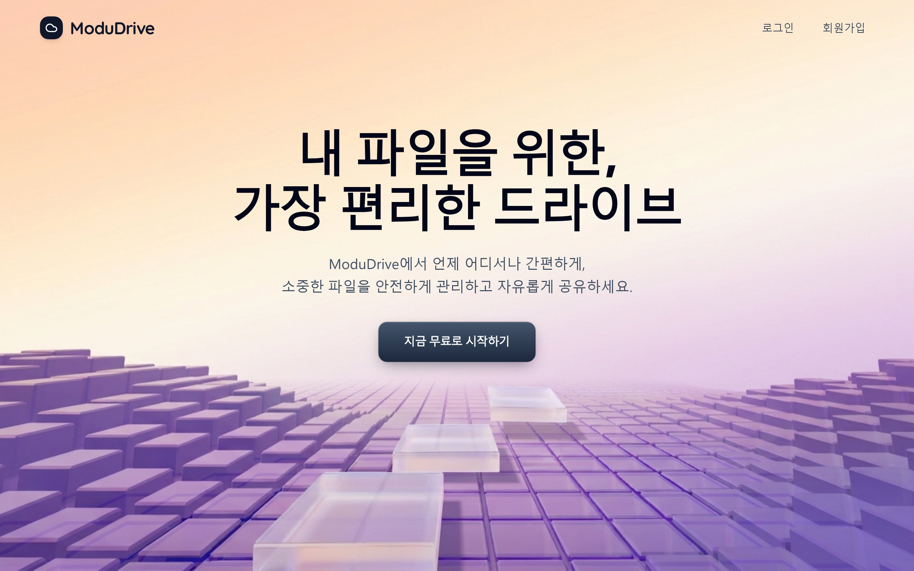
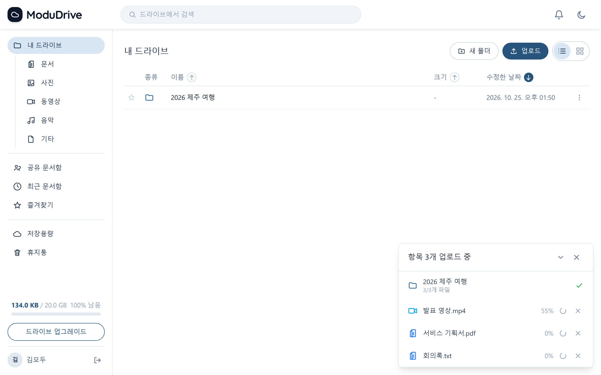
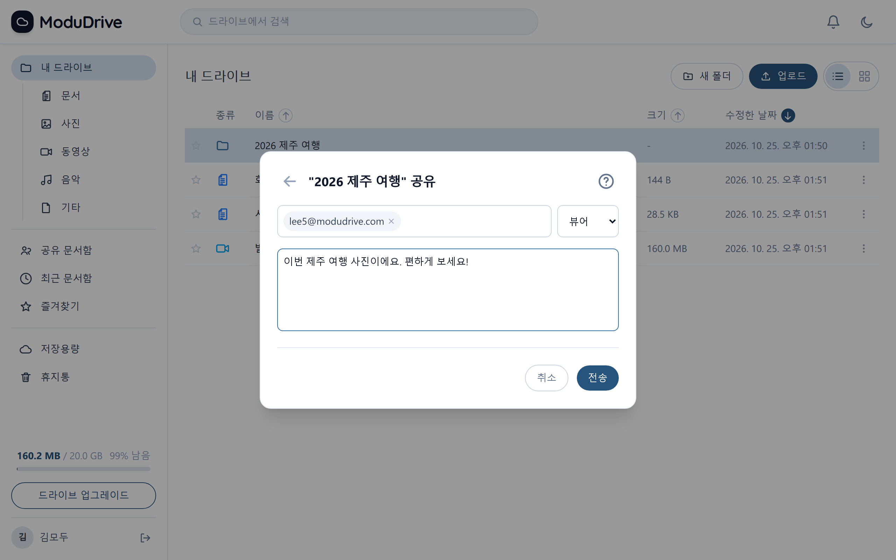
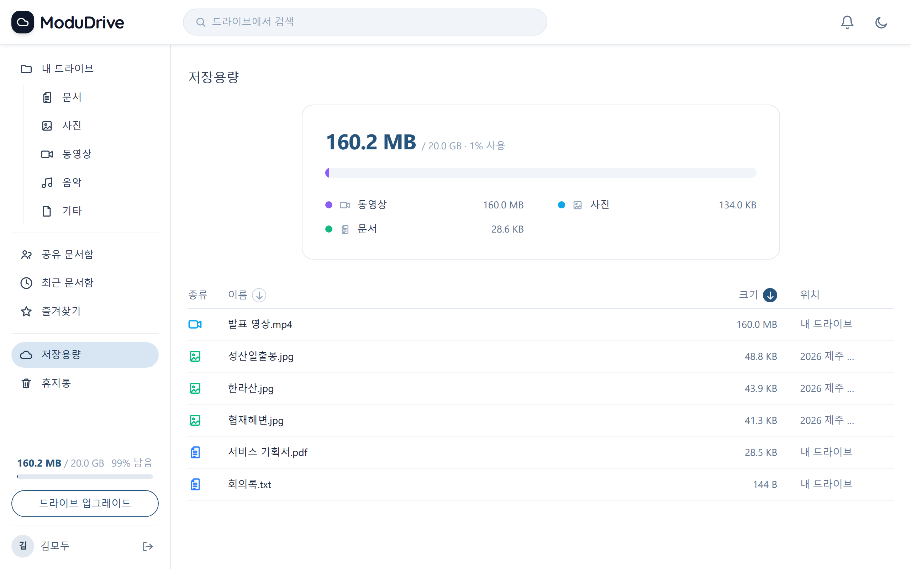
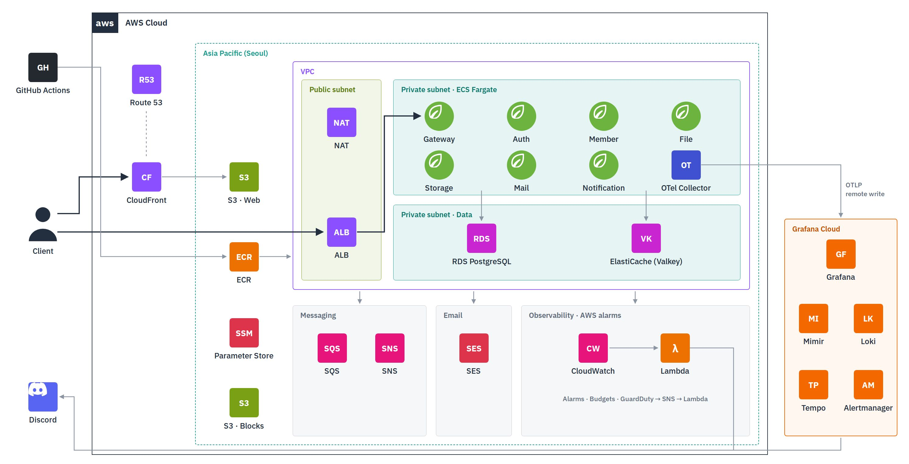

ModuDrive에서 언제 어디서나 간편하게, 
소중한 파일을 안전하게 관리하고 자유롭게 공유하세요.

🔗 <a href="https://app.modudrive.help"><b>app.modudrive.help</b></a>

 

## 1. 개요

 

모두드라이브는 파일을 안전하게 보관하고, 다른 사람과 공유할 수 있는 **클라우드 드라이브 서비스**입니다.

파일을 4MB 블록의 해시 목록으로 표현해 변경된 블록만 전송하고, 블록은 Presigned URL로 S3에 직접 올려 서버를 거치지 않는 **블록 기반 업로드**를 구현해 대용량 파일도 빠르고 효율적으로 올릴 수 있게 하였습니다.

또한 비동기 메시징과 서킷 브레이커 기반 장애 격리를 적용해, 일부 서비스나 외부 시스템에 장애가 발생해도 안정적으로 서비스할 수 있는 시스템을 구축하였습니다.

 

### 서비스 화면

 

<table>
  <tr>
    <td width="50%" valign="top">
      
      
<b>홈</b>

    </td>
    <td width="50%" valign="top">
      
      
<b>업로드</b>

    </td>
  </tr>
  <tr>
    <td width="50%" valign="top">
      
      
<b>공유</b>

    </td>
    <td width="50%" valign="top">
      
      
<b>저장용량</b>

    </td>
  </tr>
</table>

 

---

## 2. 핵심 구현

 

**블록 기반 업로드** &nbsp; 파일을 4MB 블록의 해시 목록으로 표현합니다. 서버에 없는 블록만 Presigned URL로 S3에 직접 올리고, 끊긴 업로드는 남은 블록부터 이어 올립니다.

**메시징 정합성** &nbsp; 서비스 간 이벤트는 Transactional Outbox로 DB 변경과 함께 기록해 SQS로 보내고, 받는 쪽은 중복 처리를 막습니다. 끝내 처리하지 못한 메시지는 DLQ로 옮기고 알림을 보냅니다.

**장애 격리** &nbsp; 서비스 간 호출과 외부 API(메일 발송)에 서킷 브레이커·재시도·시간 제한을 걸어, 한 곳의 장애가 전체로 번지지 않게 했습니다.

**관측성** &nbsp; 게이트웨이부터 메시지 소비까지 하나의 trace로 이어지고, 지표·로그·trace가 서로 연결됩니다. 장애는 Discord 채널별로 알립니다.

**인프라 자동화** &nbsp; AWS 인프라를 Terraform으로 구성하고, GitHub Actions가 바뀐 서비스만 테스트·빌드해 ECS에 배포합니다.

 

---

## 3. 시스템 아키텍처

 

  

<table align="center">
  <tr><th>서비스</th><th>역할</th></tr>
  <tr><td><code>gateway-service</code></td><td>요청 진입점 · 세션 인증 · CSRF 차단</td></tr>
  <tr><td><code>auth-service</code></td><td>로그인 · 세션 관리 · 새 기기 이메일 인증</td></tr>
  <tr><td><code>member-service</code></td><td>회원가입 · 회원 정보 · 비밀번호 검증</td></tr>
  <tr><td><code>file-service</code></td><td>파일·폴더 관리 · 버전 · 공유</td></tr>
  <tr><td><code>storage-service</code></td><td>S3 블록 업로드 · 다운로드</td></tr>
  <tr><td><code>mail-service</code></td><td>인증·공유 메일 발송</td></tr>
  <tr><td><code>notification-service</code></td><td>인앱 알림</td></tr>
</table>

 

---

## 4. 기술적 의사결정

 

- [파일 업로드 설계하기 (블록 기반)](https://nicky777.tistory.com/27)
- [분산 트레이싱 도입](https://github.com/rivertw777/ModuDrive-API/wiki/%EB%B6%84%EC%82%B0-%ED%8A%B8%EB%A0%88%EC%9D%B4%EC%8B%B1-%EB%8F%84%EC%9E%85)

 

---

## 5. 트러블슈팅

 

- [외부 메일 API 장애 대응하기 (멱등성 보장하기)](https://nicky777.tistory.com/26)
- [폴더 삭제 기능 성능 개선](https://github.com/rivertw777/ModuDrive-API/wiki/%ED%8F%B4%EB%8D%94-%EC%82%AD%EC%A0%9C-%EA%B8%B0%EB%8A%A5-%EC%84%B1%EB%8A%A5-%EA%B0%9C%EC%84%A0)

 

---

## 6. 설계 문서

 

- [파일 업로드 스펙](./.docs/spec/001-file-upload-spec.md)
- [파일 다운로드 스펙](./.docs/spec/002-file-download-spec.md)
- [파일/폴더 공유 기능 스펙](./.docs/spec/003-file-sharing-spec.md)
- [인증 스펙](./.docs/spec/004-auth-spec.md)
- [비동기 메시징 스펙](./.docs/spec/005-messaging-spec.md)
- [장애 대응 (Resilience) 스펙](./.docs/spec/006-resilience-spec.md)
- [로깅 스펙](./.docs/spec/007-logging-spec.md)
- [모니터링 스펙](./.docs/spec/008-observability-spec.md)
- [디스코드 알림 스펙](./.docs/spec/009-discord-alert-spec.md)

 

---

## 7. 구성 가이드

 

- [DB 마이그레이션 (Flyway)](./.docs/guide/001-db-migration.md)
- [AWS 마이그레이션](./.docs/guide/002-aws-migration.md)

 

---

## 8. 기술 스택

 

<table align="center">
    <tr>
        <th align="center">카테고리</th>
        <th align="center">기술/도구</th>
    </tr>
    <tr>
        <td align="center"><strong>Backend</strong></td>
        <td align="center">    </td>
    </tr>
    <tr>
        <td align="center"><strong>Database</strong></td>
        <td align="center">  </td>
    </tr>
    <tr>
        <td align="center"><strong>Cache</strong></td>
        <td align="center">  </td>
    </tr>
    <tr>
        <td align="center"><strong>Messaging</strong></td>
        <td align="center">  </td>
    </tr>
    <tr>
        <td align="center"><strong>Storage</strong></td>
        <td align="center">  </td>
    </tr>
    <tr>
        <td align="center"><strong>Mail</strong></td>
        <td align="center">  </td>
    </tr>
    <tr>
        <td align="center"><strong>Container</strong></td>
        <td align="center">   </td>
    </tr>
    <tr>
        <td align="center"><strong>IaC · CI/CD</strong></td>
        <td align="center">   </td>
    </tr>
    <tr>
        <td align="center"><strong>Monitoring</strong></td>
        <td align="center">   </td>
    </tr>
    <tr>
        <td align="center"><strong>Alert</strong></td>
        <td align="center">  </td>
    </tr>
    <tr>
        <td align="center"><strong>Test</strong></td>
        <td align="center">   </td>
    </tr>
</table>

